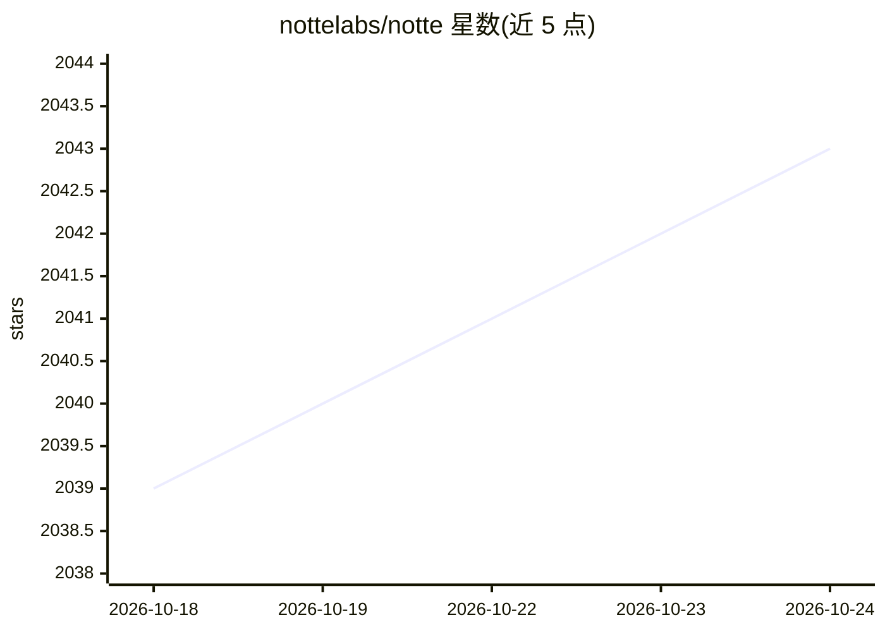

# nottelabs/notte

⭐ 2,043 · Python · NOASSERTION · 推送 2026-10-24 · [GitHub](https://github.com/nottelabs/notte) · [官网](https://console.notte.cc) · 组织维护

**给 AI agent 与脚本用的浏览器自动化基础设施与云浏览器平台**

为 AI agent 和自动化脚本提供浏览器运行环境：开源核心包含基于 Playwright 的本地浏览器会话，可将页面转为可执行观察与 markdown，并支持结构化抓取（可选 LLM 提取器，经 OpenRouter 或任意 OpenAI 兼容端点调用）。付费 API 服务提供带隐身、验证码求解与代理的云端浏览器、函数部署、凭据保险库与数字身份。云端会话暴露 CDP 端点，可沿用既有 Playwright/Puppeteer/Selenium 代码。1.10 版移除了内置 agent 循环，编码 agent 改经 CLI、MCP 或 SDK 驱动。采用 SSPL-1.0 许可。

## 筛选速览

| 维度 | 判定 | 备注 |
|---|---|---|
| AI 角色 | `ai-enhanced` | 去掉 AI 部分产品仍成立 |
| 许可风险 | `viral` | NOASSERTION |
| 部署形态 | `library` | 以包/库形式分发 |
| 模型依赖 | — | README 未给出锁定关系 |
| 硬件要求 | — | 无带数字的原话,不猜 |
| 安装摩擦 | `low` | 无编译、无系统依赖或容器化 |
| 成熟度 | — | 结构信号不足 |

## 能力要点

- 基于 Playwright 的本地浏览器会话，页面转观察动作与 markdown，无需 API key
- 云端隐身浏览器带验证码求解、代理与反检测，暴露 CDP 端点兼容 Playwright/Puppeteer/Selenium
- 凭据保险库使代码与 LLM 只见占位符；数字身份自带邮箱并可读验证码
- 浏览器函数可部署为 API、定时任务；抓取支持 Pydantic 结构化输出

## 适用场景

- 让编码 agent 通过 CLI 或 MCP 获得云端浏览器执行网页任务
- 在隐身云浏览器上运行抓取或自动化脚本并输出结构化数据
- 把浏览器自动化脚本部署为 API 端点或定时任务
- 将账号凭据存入保险库，避免明文出现在代码中

## 场景标签

`浏览器自动化` `网页抓取` · 领域:效率与自动化

## 证据(README 行号)

> L17: Notte gives AI agents and scripts a reliable browser. Drive cloud browser sessions with built-in stealth, CAPTCHA s
> L31: - **Local browser sessions** → A Playwright-based browser that turns pages into actionable observations and clean m

## 星数曲线

2026-10-18 2,039 → 2026-10-24 2,043（+4）

---
*卡片 v1 · prompt 1.4 · 生成 2026-10-21 · 置信度 high · 依据 README sha `f576ef6277af` · [字段定义](../../DATASET.md)*
