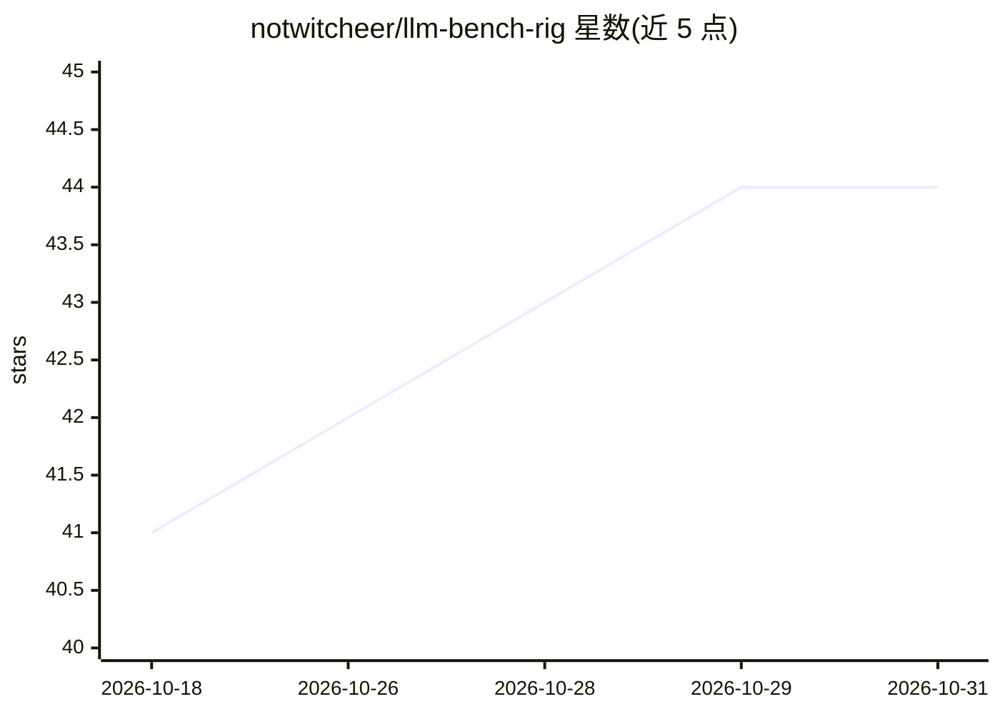

# notwitcheer/llm-bench-rig

⭐ 44 · Python · 推送 2026-10-30 · [GitHub](https://github.com/notwitcheer/llm-bench-rig) · 个人维护

**NVIDIA GPU 上的 LLM 双引擎基准测试流水线**

面向 GGUF 与 safetensors 模型的基准测试流水线：llama.cpp 负责 GGUF，vLLM（可选）负责 safetensors，产出结构化 JSON、FastAPI+SSE 实时仪表盘与可发布的 HTML 报告/PNG 卡片。速度测试跑 llama-bench 扫描与服务端流式计时（TTFT 百分位）；质量测试用自研生成式评测器跑 MMLU、ARC-Challenge、HellaSwag、GSM8K、HumanEval 五项（不依赖 lm-evaluation-harness，多项选择分数为生成式而非似然式，与 harness 结果可有数分差异），另有 Wilson 95% 区间与 provenance 溯源块。需 CUDA GPU 与 CUDA 版 llama.cpp。

## 筛选速览

| 维度 | 判定 | 备注 |
|---|---|---|
| AI 角色 | `ai-ecosystem` | LLM/agent 周边工具 |
| 许可风险 | `none` | — |
| 部署形态 | `None` |  |
| 模型依赖 | local-ok | 支持本地模型 |
| 硬件要求 | — | 无带数字的原话,不猜 |
| 安装摩擦 | `medium` | 含编译或系统依赖之一 |
| 成熟度 | — | 结构信号不足 |

## 能力要点

- 双引擎：llama.cpp（GGUF）+ vLLM（safetensors）
- 五项质量基准用自研生成式评测器，含 Wilson 误差区间
- 每次运行写入 provenance 块（构建哈希、命令行、模型 sha256）可溯源
- FastAPI+SSE 实时仪表盘与 PNG/HTML 报告导出

## 适用场景

- 在自有 NVIDIA GPU 上对比多个本地模型的吞吐与质量
- 批量排队测试多个模型并在模型间设审查门
- 生成可发布的基准卡片用于分享结果

## 场景标签

`模型评测` · 领域:评测与运维

## 证据(README 行号)

> L5: Dual-engine: **llama.cpp** for GGUF models, **vLLM** for safetensors. Produces structured JSON results, live web das
> L9: - **Speed benchmarks**: a llama-bench sweep, `-p 128,512,2048,4096,8192,16384 -n 128` (prompt processing at six cont
> L10: - **Quality benchmarks**: five board tasks (MMLU, ARC-Challenge, HellaSwag, GSM8K, HumanEval) run through our own g

## 星数曲线

2026-10-18 41 → 2026-10-31 44（+3）

---
*卡片 v1 · prompt 1.4 · 生成 2026-10-25 · 置信度 high · 依据 README sha `f5cd3c2cde5c` · [字段定义](../../DATASET.md)*
