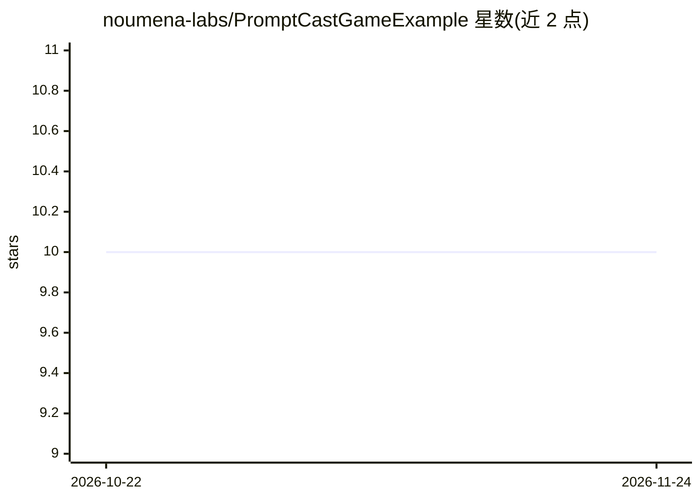

# noumena-labs/PromptCastGameExample

⭐ 10 · TypeScript · MIT · 推送 2026-06-29 · [GitHub](https://github.com/noumena-labs/PromptCastGameExample) · [官网](https://promptcast.dev) · 组织维护

**浏览器内本地 LLM 驱动的 P2P 自然语言 3D 咏唱对战游戏示例**

PromptCast 是一个基于 Next.js + React Three Fiber + Rapier 的 1v1 法术对决游戏示例，玩家用自然语言输入咒语；本地 LLM（通过 @sipphq/sipp 完全加载在浏览器内，GGUF 模型缓存于 OPFS）经多阶段流水线（concept→balance）将提示解析为符合 Zod 校验的 JSON 法术，驱动 VFX、刚体投射物与音频。多人对战通过 PeerJS 走 WebRTC P2P，房主为权威节点。面向想构建本地 LLM 驱动游戏/交互应用的开发者，提供完整源码、调试面板与开发工具路由。

## 筛选速览

| 维度 | 判定 | 备注 |
|---|---|---|
| AI 角色 | `ai-native` | 本体是模型或模型工具 |
| 许可风险 | `permissive` | MIT |
| 部署形态 | `library` | 以包/库形式分发 |
| 模型依赖 | — | README 未给出锁定关系 |
| 硬件要求 | — | 无带数字的原话,不猜 |
| 安装摩擦 | `low` | 无编译、无系统依赖或容器化 |
| 成熟度 | — | 结构信号不足 |

## 能力要点

- LLM 完全在浏览器内运行（@sipphq/sipp，GGUF 模型缓存于 OPFS），服务端无需模型 API key
- 语法约束的多阶段流水线将自然语言转为经 Zod 校验的结构化 JSON 法术
- P2P 多人对战：房主 sigil 即地址，基于 PeerJS/WebRTC，无需自建信令（可自托管 broker）
- 提供网络/AI 调试面板、VFX 预览与音频库等开发者工具路由

## 适用场景

- 与朋友用自然语言咏唱咒语进行 1v1 法术对决
- 学习如何在浏览器内加载和调用本地 GGUF 模型
- 参考 LLM 输出约束（grammar+Zod）构建游戏内 AI 解析管线
- 体验无需服务端推理的 P2P 联机对战

## 场景标签

 · 领域:游戏开发/本地 AI 应用

## 证据(README 行号)

> L5: PromptCast is a browser-based, peer-to-peer 3D spell duel where players cast in **natural language**. A local LLM (l
> L15: **Technical pitch.** PromptCast is an AI-driven 1v1 spell battler built on Next.js + React Three Fiber + Rapier. Pl
> L29: |AI|`@sipphq/sipp` (in-browser LLM, GGUF via OPFS)|

## 星数曲线

2026-10-22 10 → 2026-11-24 10（+0）

---
*卡片 v1 · prompt 1.4 · 生成 2026-11-19 · 置信度 high · 依据 README sha `e27abffdeb33` · [字段定义](../../DATASET.md)*
