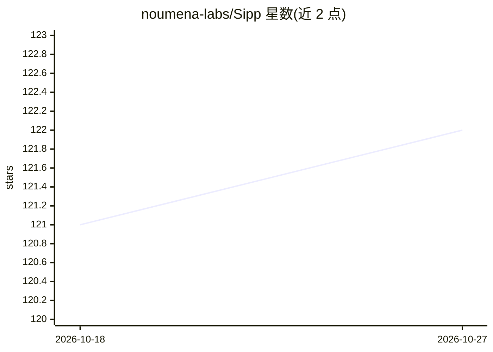

# noumena-labs/Sipp

⭐ 122 · Rust · Apache-2.0 · 推送 2026-10-16 · [GitHub](https://github.com/noumena-labs/Sipp) · [官网](https://www.sipp.sh) · 组织维护 · 中文 README

**面向 Web/桌面/边缘的 GGUF 推理运行时与统一 SDK**

Sipp 是用 Rust 与 C++ 构建的 AI 推理框架，核心 Sipp Engine 以 WebGPU 在浏览器、桌面或云裸金属上运行 GGUF 模型。它以 SDK 形式提供浏览器、Node.js、Rust、Python、Swift 与云网关等多种包面，API 对称统一，可在本地执行与云厂商路由之间切换；网关代理持有模型路径、凭证与访问策略。README 附带与 WebLLM、Transformers.js 的基准对比数据，并声明处于活跃开发期、可能有破坏性变更，不适合关键生产环境。

## 筛选速览

| 维度 | 判定 | 备注 |
|---|---|---|
| AI 角色 | `ai-ecosystem` | LLM/agent 周边工具 |
| 许可风险 | `permissive` | Apache-2.0 |
| 部署形态 | `desktop` | 安装包/桌面程序 |
| 模型依赖 | — | README 未给出锁定关系 |
| 硬件要求 | — | 无带数字的原话,不猜 |
| 安装摩擦 | `low` | 无编译、无系统依赖或容器化 |
| 成熟度 | `idea` | |

## 能力要点

- WebGPU 引擎在浏览器/桌面/边缘运行 GGUF 模型
- 本地、云厂商与网关推理的统一对称 API
- 多语言包面：浏览器、Node.js、Rust、Python、Swift、云网关
- 内置 Next.js / TanStack / React+Vite 集成蓝图与 SSE 流式支持

## 适用场景

- 在浏览器中本地运行 GGUF 模型做客户端推理
- 用同一套 API 在本地与云网关之间切换推理路径
- 通过网关代理集中管理模型路径与 API 密钥
- 构建边缘-云混合的流式 AI 应用

## 场景标签

`推理引擎` · 领域:训练与推理

## 证据(README 行号)

> L31: Sipp is an all-in-one, high-performance AI framework for building web, desktop, and edge applications. It ships as 
> L33: At its core is **Sipp Engine**, a blazing-fast runtime built to run anywhere: in the browser, on the desktop, or on

## 星数曲线

2026-10-18 121 → 2026-10-27 122（+1）

---
*卡片 v1 · prompt 1.4 · 生成 2026-10-23 · 置信度 high · 依据 README sha `7a0eda9a2380` · [字段定义](../../DATASET.md)*
