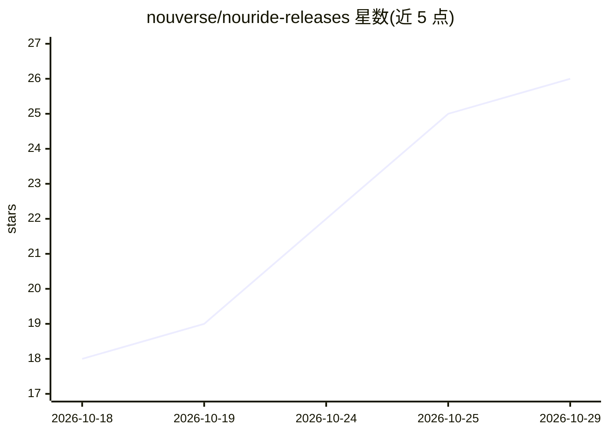

# nouverse/nouride-releases

⭐ 26 · Shell · 推送 2026-10-28 · [GitHub](https://github.com/nouverse/nouride-releases) · [官网](nouride.com) · 组织维护

**面向家庭服务器与迷你设备的单守护进程多 agent AI 引擎**

Nouverse Technologies 开发的单一二进制守护进程，将 Discord、Telegram、WhatsApp 等聊天平台接入隔离的 AI agent，提供独立人设、共享技能池、工具执行审批门、定时任务、长任务与 Web 仪表盘。支持 Linux（含树莓派/Alpine）、Apple Silicon macOS 原生安装、Docker 多架构镜像与独立 tarball。Router 变体内置 Nougate LLM 网关（OpenAI/Anthropic 兼容 API，端口 18256），可无外部网关应答模型调用。核心引擎在内部仓库开发，本仓库负责二进制分发与社区反馈。

## 筛选速览

| 维度 | 判定 | 备注 |
|---|---|---|
| AI 角色 | `ai-ecosystem` | LLM/agent 周边工具 |
| 许可风险 | `none` | — |
| 部署形态 | `desktop` | 安装包/桌面程序 |
| 模型依赖 | — | README 未给出锁定关系 |
| 硬件要求 | — | 无带数字的原话,不猜 |
| 安装摩擦 | `low` | 无编译、无系统依赖或容器化 |
| 成熟度 | — | 结构信号不足 |

## 能力要点

- 单二进制守护进程，自带嵌入式运行时与 Web 仪表盘
- 多聊天平台接入隔离 agent（人设/技能池/审批门/定时任务）
- Router 变体内置 Nougate LLM 网关，提供 OpenAI/Anthropic 兼容 API
- Linux 多发行版/Apple Silicon/Docker 多架构分发，附 SHA256 校验

## 适用场景

- 在树莓派或家庭服务器上跑多平台聊天 agent
- 让 agent 独立执行长任务并经审批门调用工具
- 用内置 LLM 网关在无外部网关的设备上应答模型调用

## 场景标签

`多智能体` `模型网关` · 领域:Agent 开发

## 证据(README 行号)

> L5: Nouride is an ultra-lightweight, zero-bloat multi-agent AI engine in a single binary daemon. Built for servers, home
> L85: `nouride-router` is the same build **plus the Nougate AI Router in the same process** — model calls

## 星数曲线

2026-10-18 18 → 2026-10-29 26（+8）

---
*卡片 v1 · prompt 1.4 · 生成 2026-10-27 · 置信度 high · 依据 README sha `c647fb3b7e6b` · [字段定义](../../DATASET.md)*
