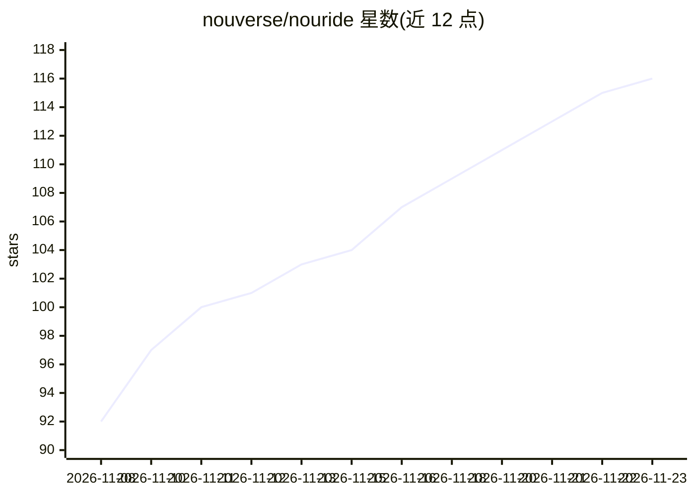

# nouverse/nouride

⭐ 116 · TypeScript · NOASSERTION · 推送 2026-11-22 · [GitHub](https://github.com/nouverse/nouride) · [官网](nouride.com) · 组织维护

**在自有小主机上运行多个 AI agent 的单二进制守护进程**

面向 homelab 与迷你设备（树莓派、Orange Pi、NUC、LXC 等）的多 agent 运行引擎：单个守护进程内运行多个 agent，各自拥有独立人设、模型、聊天渠道与工具，通过 Telegram、Discord、WhatsApp 或网页仪表盘对话。内置 Nougate LLM 网关，可用已有的 Claude/ChatGPT/Copilot/Gemini/Kiro 账号登录替代 API key。提供任务审批、本地记忆存储、技能与连接器池。以 Linux/macOS 安装脚本、Docker 镜像与独立 tarball 分发；许可为 FSL-1.1-ALv2，另有不在本仓库的 Pro 版组件。

## 筛选速览

| 维度 | 判定 | 备注 |
|---|---|---|
| AI 角色 | `ai-native` | 本体是模型或模型工具 |
| 许可风险 | `none` | NOASSERTION |
| 部署形态 | `desktop` | 安装包/桌面程序 |
| 模型依赖 | — | README 未给出锁定关系 |
| 硬件要求 | — | 无带数字的原话,不猜 |
| 安装摩擦 | `low` | 无编译、无系统依赖或容器化 |
| 成熟度 | — | 结构信号不足 |

## 能力要点

- 单二进制守护进程，64 MB 内存启动、待机占用低于单核 1%
- 多 agent 各自独立人设/模型/渠道，可在同一房间被 @ 指定
- 内置 Nougate LLM 网关（端口 18256），支持 OpenAI/Anthropic 兼容接口
- 敏感操作需用户批准（一次/总是/拒绝），密钥本机加密存储

## 适用场景

- 在家里的小主机上长期跑几个私人 AI agent，从常用聊天软件对话
- 给 agent 布置任务，让它自主完成并跟踪清单
- 不使用 API key、改用已有 AI 账号订阅接入模型

## 场景标签

`多智能体` · 领域:Agent 开发

## 证据(README 行号)

> L22:  A few agents, each its own. Every agent has its own personality, model, chat apps and tools. They all run in
> L26:  Say hi from the apps you already use. Telegram, Discord, WhatsApp, or the web dashboard. Put several agents in
> L143: Every install carries the Nougate LLM gateway in the same process: model calls answered from inside the daemon, wi

## 星数曲线

2026-11-08 92 → 2026-11-23 116（+24）

---
*卡片 v1 · prompt 1.4 · 生成 2026-11-17 · 置信度 high · 依据 README sha `3a6443884a99` · [字段定义](../../DATASET.md)*
