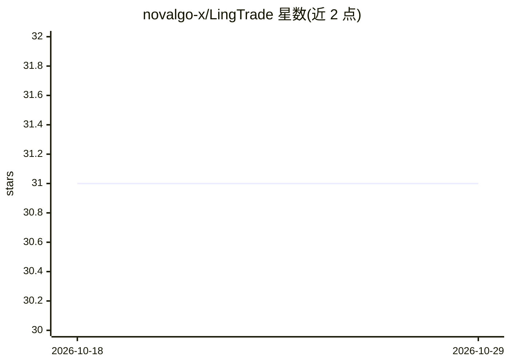

# novalgo-x/LingTrade

⭐ 31 · TypeScript · AGPL-3.0 · 推送 2026-09-22 · [GitHub](https://github.com/novalgo-x/LingTrade) · 组织维护 · 中文 README

**面向个人的 A 股 AI 投研工作站：多智能体分析与模拟交易**

本地部署的 A 股投研 Web 应用：多个 AI Agent 协作完成基本面扫描、技术面研判与风险评估，保留完整推理链路；支持从投研到模拟交易决策、持仓跟踪的闭环，不提供实盘交易功能。内置可上传研报与笔记的个人知识库（PDF/Word/Markdown/纯文本，LLM 生成结构化摘要存入 SQLite）。数据来自 Tushare 接口，LLM 调用通过 OpenAI 兼容协议接入 DeepSeek、通义千问、Kimi、Claude、GPT 等。全栈 TypeScript，Node.js >= 20，脚本安装启动，无需外部数据库。

## 筛选速览

| 维度 | 判定 | 备注 |
|---|---|---|
| AI 角色 | `ai-native` | 本体是模型或模型工具 |
| 许可风险 | `viral` | AGPL-3.0 |
| 部署形态 | `None` |  |
| 模型依赖 | locked-api |  |
| 硬件要求 | — | 无带数字的原话,不猜 |
| 安装摩擦 | `low` | 无编译、无系统依赖或容器化 |
| 成熟度 | — | 结构信号不足 |

## 能力要点

- 多 Agent 协作投研分析，推理链路完整留痕
- 模拟交易闭环：决策、风控校验、执行结果逐笔可查
- 个人知识库上传研报/笔记，AI 解析摘要纳入分析上下文
- LLM 调用走 OpenAI 兼容协议，可为不同 Agent 角色分配不同模型

## 适用场景

- 本地跑一个 A 股 AI 投研分析环境学习 AI 决策过程
- 把个人研报和笔记建成知识库参与投研分析
- 在模拟环境里跟踪 Agent 的交易决策与风控校验

## 场景标签

`多智能体` `知识库管理` `金融量化` · 领域:Agent 开发

## 证据(README 行号)

> L34: 由多个 AI Agent 协作完成投研全流程——从基本面扫描、技术面研判到风险评估，每一步分析均保留完整推理链路，研究过程完全透明可追溯。所有输出为模拟生成的研究性内容，帮助你理解 AI 分析的思考路径。
> L67:  投研报告 — AI 模拟生成的个股深度分析，含估值、风险、多空辩论。
> L139: 全栈 TypeScript 构建。前端基于 React 19 + Vite，后端为 Express + SQLite，无需外部数据库。底层分析由 CLI 引擎驱动，与 Web 解耦，也可独立调用。所有 LLM 调用通过 Open

## 星数曲线

2026-10-18 31 → 2026-10-29 31（+0）

---
*卡片 v1 · prompt 1.4 · 生成 2026-10-26 · 置信度 high · 依据 README sha `614b76dca76b` · [字段定义](../../DATASET.md)*
