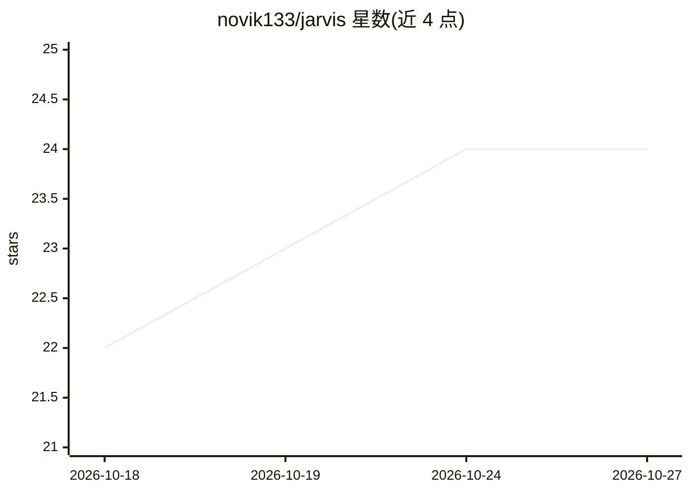

# novik133/jarvis

⭐ 24 · C++ · GPL-3.0 · 推送 2026-03-28 · [GitHub](https://github.com/novik133/jarvis) · 个人维护

**KDE Plasma 6 桌面的全本地 AI 语音助手（中文≤30字不适用，英文原名保留）**

面向 KDE Plasma 6 用户的全本地、离线 AI 助手 Plasmoid：内置 llama.cpp 提供本地 LLM 对话（自带 llama-server 可从设置界面启停），whisper.cpp 做唤醒词与语音命令（CPU-only），Piper TTS 语音播报。LLM 生成结构化动作块由后端执行，支持运行命令、写文件、打开应用、输入文本等系统交互；另含实时系统监控、定时提醒与钢铁侠风格 HUD。C++/QML 实现，GPL-3.0，需从源码构建安装。

## 筛选速览

| 维度 | 判定 | 备注 |
|---|---|---|
| AI 角色 | `ai-native` | 本体是模型或模型工具 |
| 许可风险 | `viral` | GPL-3.0 |
| 部署形态 | `desktop` | 安装包/桌面程序 |
| 模型依赖 | local-ok | 支持本地模型 |
| 硬件要求 | `cpu-ok` | |
| 安装摩擦 | `low` | 无编译、无系统依赖或容器化 |
| 成熟度 | — | 结构信号不足 |

## 能力要点

- 内置 llama.cpp + whisper.cpp，无需单独安装，100% 离线运行
- 唤醒词 'Jarvis' + 14 条内置语音命令，映射可自定义
- LLM 生成结构化动作块（run_command/write_file/open_app 等）执行系统操作
- 资源占用低：插件 ~15 MB 内存，LLM 服务器 ~500 MB+

## 适用场景

- 在 KDE Plasma 桌面上离线使用语音唤醒的 AI 助手
- 通过自然语言让助手打开应用、写文件、执行命令
- 本地运行 LLM 对话而不依赖云服务

## 场景标签

`AI 助手` `语音 Agent` · 领域:对话与助手

## 证据(README 行号)

> L10:  A fully local AI assistant for KDE Plasma 6, inspired by Tony Stark's iconic AI.
> L42: |**Local LLM Chat**|Conversational AI via llama.cpp — no cloud, no API keys|

## 星数曲线

2026-10-18 22 → 2026-10-27 24（+2）

---
*卡片 v1 · prompt 1.4 · 生成 2026-10-27 · 置信度 high · 依据 README sha `12ce6e1e9486` · [字段定义](../../DATASET.md)*
