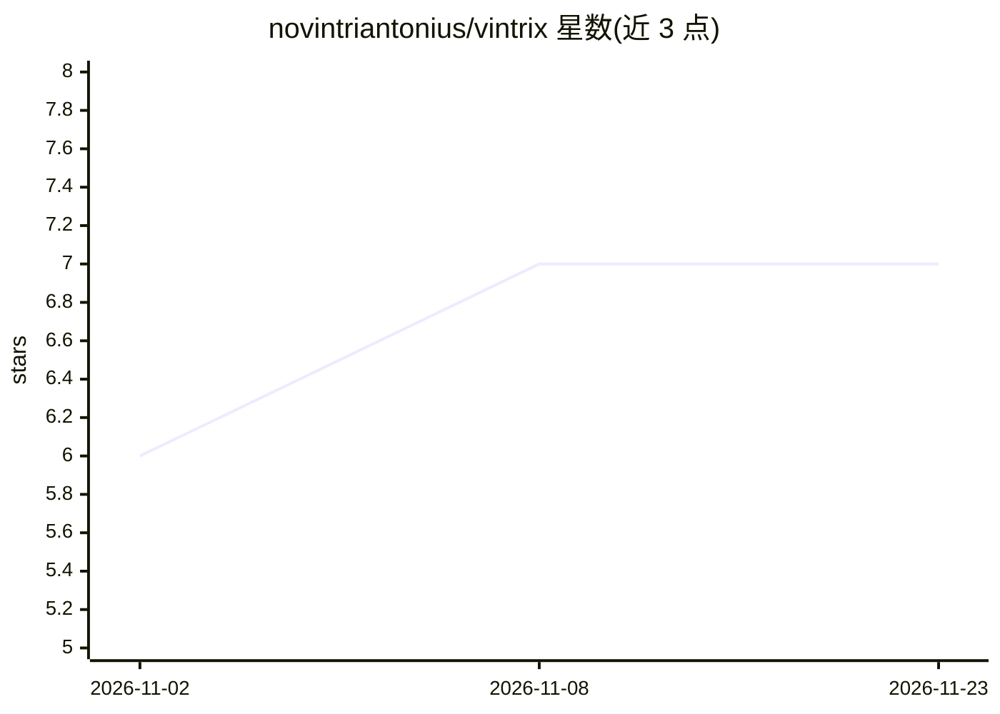

# novintriantonius/vintrix

⭐ 7 · TypeScript · MIT · 推送 2026-10-31 · [GitHub](https://github.com/novintriantonius/vintrix) · 个人维护

**自托管代码库知识图谱平台：将仓库转为可交互图并带上下文 AI 问答**

Vintrix 将多仓库或单体代码库转换为可查询的知识图谱：内存中 TypeScript/JavaScript AST 解析提取函数、类、接口、路由等结构关系，检索层合并 BM25 词法排序与语义向量匹配，前端用 React Flow 呈现节点图。内置对话助手直接查询图谱回答架构问题并给出源码引用。支持 GitHub/GitLab/自托管 Git 与 SSH/SFTP 同步，凭据以 AES-256-GCM 加密存储。面向工程团队，提供 RBAC、一次性邀请链接、多工作区隔离，通过 Docker Compose 自托管运行。

## 筛选速览

| 维度 | 判定 | 备注 |
|---|---|---|
| AI 角色 | `ai-enhanced` | 去掉 AI 部分产品仍成立 |
| 许可风险 | `permissive` | MIT |
| 部署形态 | `self-host` | docker 或自建部署 |
| 模型依赖 | — | README 未给出锁定关系 |
| 硬件要求 | — | 无带数字的原话,不猜 |
| 安装摩擦 | `low` | 无编译、无系统依赖或容器化 |
| 成熟度 | `idea` | |

## 能力要点

- 内存 AST 解析提取函数/类/路由结构与调用层级
- BM25 与语义向量混合检索为 AI 提供上下文
- Git/SSH/SFTP 多源同步，凭据 AES-256-GCM 加密存储
- RBAC 四级角色与 48 小时过期的一次性邀请链接

## 适用场景

- 可视化理解多仓库项目的依赖与调用关系
- 通过对话查询架构问题并定位源码位置
- 团队自托管场景下隔离管理多个工作区

## 场景标签

`知识图谱` · 领域:知识与检索

## 证据(README 行号)

> L12: **Vintrix** transforms complex, multi-repository and monolithic codebases into interactive, queryable **Knowledge G
> L21: - 💬 **Context-Aware AI Chat & Code Explainer**: Built-in conversational assistant that queries the codebase knowled

## 星数曲线

2026-11-02 6 → 2026-11-23 7（+1）

---
*卡片 v1 · prompt 1.4 · 生成 2026-11-20 · 置信度 high · 依据 README sha `b0d8a64b4906` · [字段定义](../../DATASET.md)*
