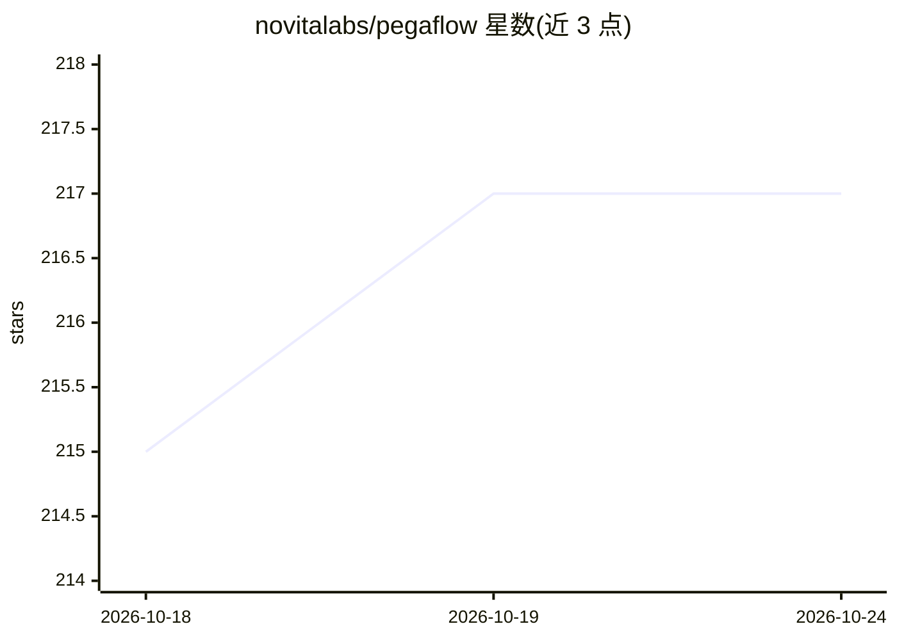

# novitalabs/pegaflow

⭐ 217 · Rust · Apache-2.0 · 推送 2026-10-20 · [GitHub](https://github.com/novitalabs/pegaflow) · 组织维护

**面向 LLM 推理的高性能 KV cache 存储引擎**

以独立 sidecar 进程形式运行的 KV cache 存储引擎，与推理生命周期解耦：将 KV cache 从 GPU 卸载到主机内存或 SSD，并支持通过 RDMA 跨节点共享。核心用 Rust 编写（GIL-free 热路径），提供 NUMA 感知的 pinned memory 与逐层 DMA 传输，内置 Prometheus 指标与 OTLP 导出。以 vLLM KV connector 形式即插即用，通过 pip 安装（区分 CUDA 12/13 版本）后启动 pegaflow-server，也可从源码用 cargo/maturin 构建。README 提供 H800 上 Llama-3.1-8B 的 TTFT 基准数据。

## 筛选速览

| 维度 | 判定 | 备注 |
|---|---|---|
| AI 角色 | `ai-ecosystem` | LLM/agent 周边工具 |
| 许可风险 | `permissive` | Apache-2.0 |
| 部署形态 | `library` | 以包/库形式分发 |
| 模型依赖 | local-ok | 支持本地模型 |
| 硬件要求 | — | 无带数字的原话,不猜 |
| 安装摩擦 | `medium` | 含编译或系统依赖之一 |
| 成熟度 | — | 结构信号不足 |

## 能力要点

- 独立 sidecar 架构，KV cache 跨引擎重启存活并可多实例共享
- GPU→内存/SSD 卸载与 RDMA 跨节点共享
- GIL-free Rust 核心，NUMA 感知 pinned memory + 逐层 DMA
- 以 vLLM drop-in KV connector 集成

## 适用场景

- vLLM 推理集群中复用 KV cache 以降低首 token 延迟
- prefill/decode 分离与跨节点 KV 传输场景
- 推理引擎重启后保留 KV cache 减少重复计算

## 场景标签

`推理引擎` · 领域:训练与推理

## 证据(README 行号)

> L9: **PegaFlow is a high-performance KV cache storage engine for LLM inference.** Offload KV cache from GPU to host memo
> L15: - **Pluggable** — works with vLLM as a drop-in KV connector

## 星数曲线

2026-10-18 215 → 2026-10-24 217（+2）

---
*卡片 v1 · prompt 1.4 · 生成 2026-10-23 · 置信度 high · 依据 README sha `6e640f9c04bf` · [字段定义](../../DATASET.md)*
