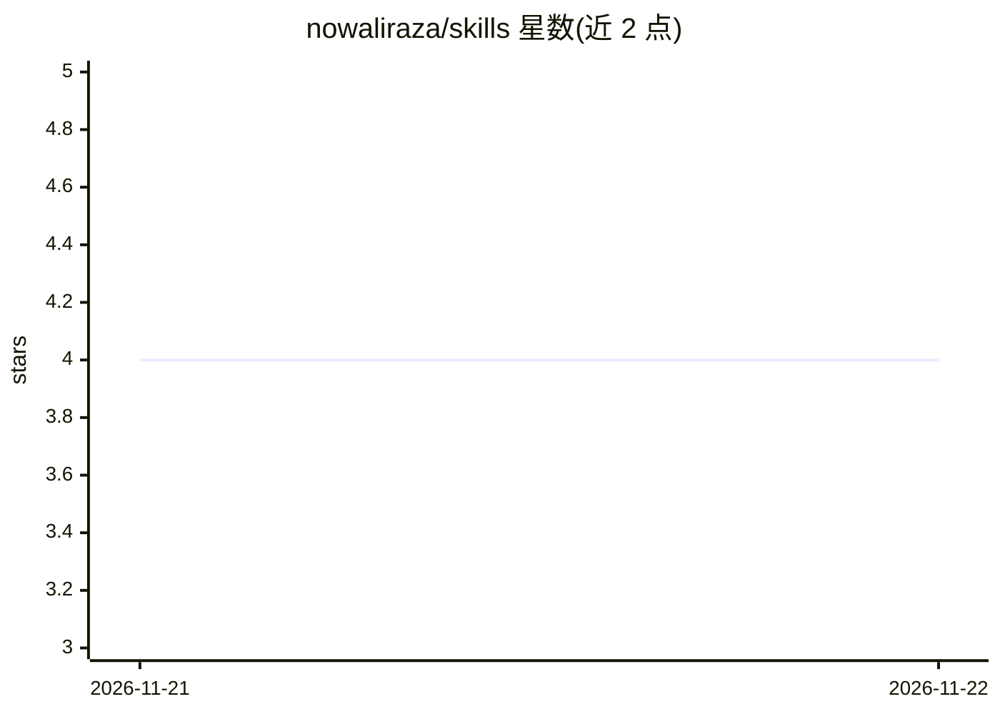

# nowaliraza/skills

⭐ 4 · MIT · 推送 2026-11-20 · [GitHub](https://github.com/nowaliraza/skills) · 个人维护

**面向生产环境工程师的 AI Agent 代码审查技能包**

为工程场景的 AI Agent 提供技能集合，当前含 review-pr 与 review-local 两个代码审查技能：前者审查他人 PR/分支/提交区间并解释变更与需求匹配度，后者在提交前对暂存区、外出提交或工作树运行项目检查，检出遗留调试代码、早期提交中的密钥等问题并按请求应用修复。以 Claude Code 插件市场形式分发，同时支持 GitHub Copilot CLI、Codex CLI、Gemini CLI、Cursor 等多种 Agent 平台安装，也可手动拷贝技能目录。

## 筛选速览

| 维度 | 判定 | 备注 |
|---|---|---|
| AI 角色 | `ai-ecosystem` | LLM/agent 周边工具 |
| 许可风险 | `none` | MIT |
| 部署形态 | `library` | 以包/库形式分发 |
| 模型依赖 | — | README 未给出锁定关系 |
| 硬件要求 | — | 无带数字的原话,不猜 |
| 安装摩擦 | `low` | 无编译、无系统依赖或容器化 |
| 成熟度 | — | 结构信号不足 |

## 能力要点

- review-pr 审查他人变更，可在有托管上下文或仅本地 Git 时工作
- review-local 提交前检查暂存/外出提交，发现遗留调试代码与密钥
- 支持 Claude Code 插件市场、Copilot CLI、Codex/Gemini CLI、Cursor 等多平台安装
- 通过 SKILL.md 与 marketplace.json 可自行添加技能

## 适用场景

- 提交或推送前让 Agent 先跑一遍自检
- 让 Agent 审查同事的 PR 并给出核验过的发现
- 给团队使用的多种 CLI Agent 统一分发审查技能

## 场景标签

`代码审查` · 领域:编码与开发

## 证据(README 行号)

> L7: These skills build that responsibility into the agent’s workflow. They make it read before writing, trace before cha
> L22: |Claude Code|`/plugin marketplace add nowaliraza/skills` then `/plugin install review-pr@nowaliraza-skills` or `rev

## 星数曲线

2026-11-21 4 → 2026-11-22 4（+0）

---
*卡片 v1 · prompt 1.4 · 生成 2026-11-21 · 置信度 high · 依据 README sha `e17fe519d826` · [字段定义](../../DATASET.md)*
