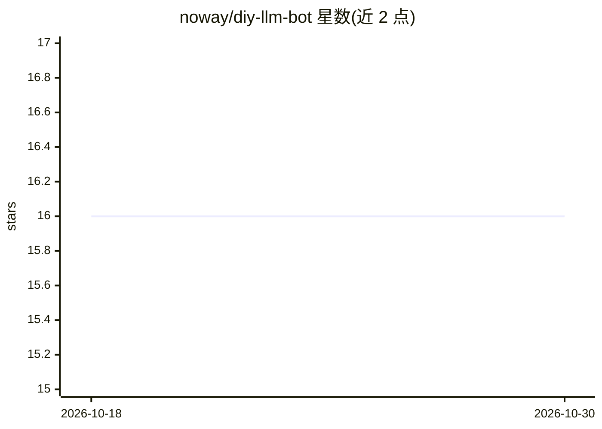

# noway/diy-llm-bot

⭐ 16 · TypeScript · MIT · 推送 2026-10-25 · [GitHub](https://github.com/noway/diy-llm-bot) · [官网](https://diy-llm-bot.com) · 个人维护

**对比 GPT-3 通用聊天机器人与 ChatGPT 回答的网页应用**

提供网页界面，用户输入问题后可对比通用 GPT-3 聊天机器人与 ChatGPT 的回答。界面支持代码片段语法高亮与 Markdown 风格格式化。明确声明非目标：不做模型定量评估与模型训练。未来目标是通过同一界面对比不同 LLM。API 部分位于独立仓库 noway/diy-llm-bot-api。README 未给出本地安装运行命令。

## 筛选速览

| 维度 | 判定 | 备注 |
|---|---|---|
| AI 角色 | `ai-native` | 本体是模型或模型工具 |
| 许可风险 | `permissive` | MIT |
| 部署形态 | `None` |  |
| 模型依赖 | — | README 未给出锁定关系 |
| 硬件要求 | — | 无带数字的原话,不猜 |
| 安装摩擦 | `low` | 无编译、无系统依赖或容器化 |
| 成熟度 | — | 结构信号不足 |

## 能力要点

- 同一界面输入问题，对比 GPT-3 通用机器人与 ChatGPT 回答
- 支持代码片段语法高亮与 Markdown 风格格式化
- API 位于独立仓库 noway/diy-llm-bot-api

## 适用场景

- 想直观感受 GPT-3 通用聊天机器人与 ChatGPT 回答差异
- 通过同一界面试问不同 AI 并比较输出

## 场景标签

`聊天机器人` · 领域:对话与助手

## 证据(README 行号)

> L3: This project allows you to compare a generic GPT-3 based chatbot with ChatGPT.
> L13: - Nice user experience of writing a question and getting an answer

## 星数曲线

2026-10-18 16 → 2026-10-30 16（+0）

---
*卡片 v1 · prompt 1.4 · 生成 2026-10-30 · 置信度 high · 依据 README sha `e454c7d5bdc0` · [字段定义](../../DATASET.md)*
