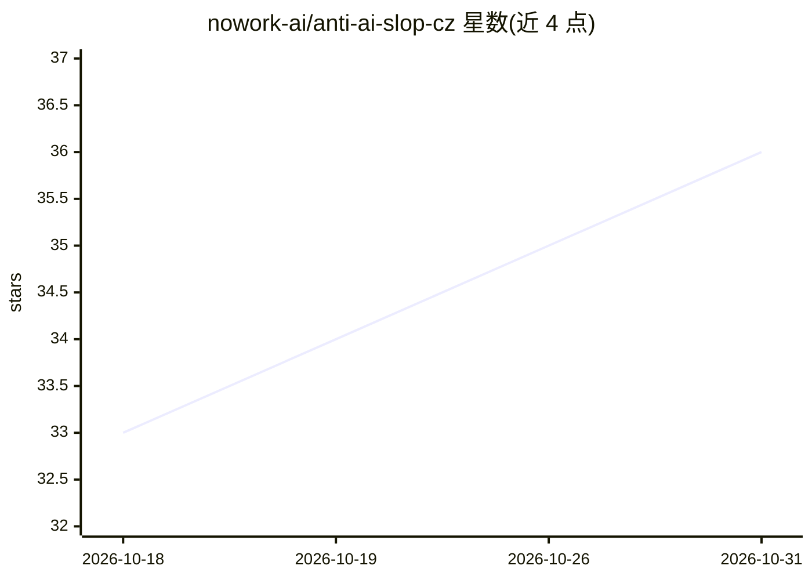

# nowork-ai/anti-ai-slop-cz

⭐ 36 · NOASSERTION · 推送 2026-10-11 · [GitHub](https://github.com/nowork-ai/anti-ai-slop-cz) · 个人维护

**让 AI 用捷克语写出像人写的文本的规则包与 agent 技能**

面向捷克语写作的反 AI slop 规则包：通过词汇、句式、标点和格式化四层规则去除 AI 生成文本的通用腔调。提供两种使用方式：将简短版 prompt 复制到 AI 聊天（ChatGPT、Claude、Gemini、Copilot）开头或设为自定义助手；或将 skill 目录（SKILL.md + references/）复制到 Claude Code、Cursor、Codex、Gemini CLI 等 agent 的技能目录。包内含短版 prompt、完整版指南与 skill 目录，灵感来自 jalaalrd/anti-ai-slop-writing 并针对捷克语改写。MIT 许可。

## 筛选速览

| 维度 | 判定 | 备注 |
|---|---|---|
| AI 角色 | `ai-knowledge` | 知识聚合/清单类 |
| 许可风险 | `none` | NOASSERTION |
| 部署形态 | `None` |  |
| 模型依赖 | — | README 未给出锁定关系 |
| 硬件要求 | — | 无带数字的原话,不猜 |
| 安装摩擦 | `low` | 无编译、无系统依赖或容器化 |
| 成熟度 | — | 结构信号不足 |

## 能力要点

- 四层规则：词汇、句式、标点、格式化
- 短版 prompt 可粘贴到聊天或设为自定义 AI 助手
- SKILL.md 格式技能目录，兼容多数编码 agent
- 含完整版指南与改写示例

## 适用场景

- 让 ChatGPT/Claude 等聊天按规则写捷克语文案
- 给 Claude Code/Cursor 等 agent 安装写作规则技能
- 企业场景中减少 AI 生成捷克语文本的模板腔

## 场景标签

`提示工程` `AI 写作` · 领域:Agent 开发

## 证据(README 行号)

> L3: Pravidla, díky kterým AI píše český text jako člověk a nikoliv jako AI generátor. Funguje ve dvou režimech: jako krá
> L9: AI slop je text, který vypadá správně, ale nic neříká. Zní univerzálně, používá silná slova bez důkazů, opakuje stej

## 星数曲线

2026-10-18 33 → 2026-10-31 36（+3）

---
*卡片 v1 · prompt 1.4 · 生成 2026-10-25 · 置信度 high · 依据 README sha `4198399f5371` · [字段定义](../../DATASET.md)*
