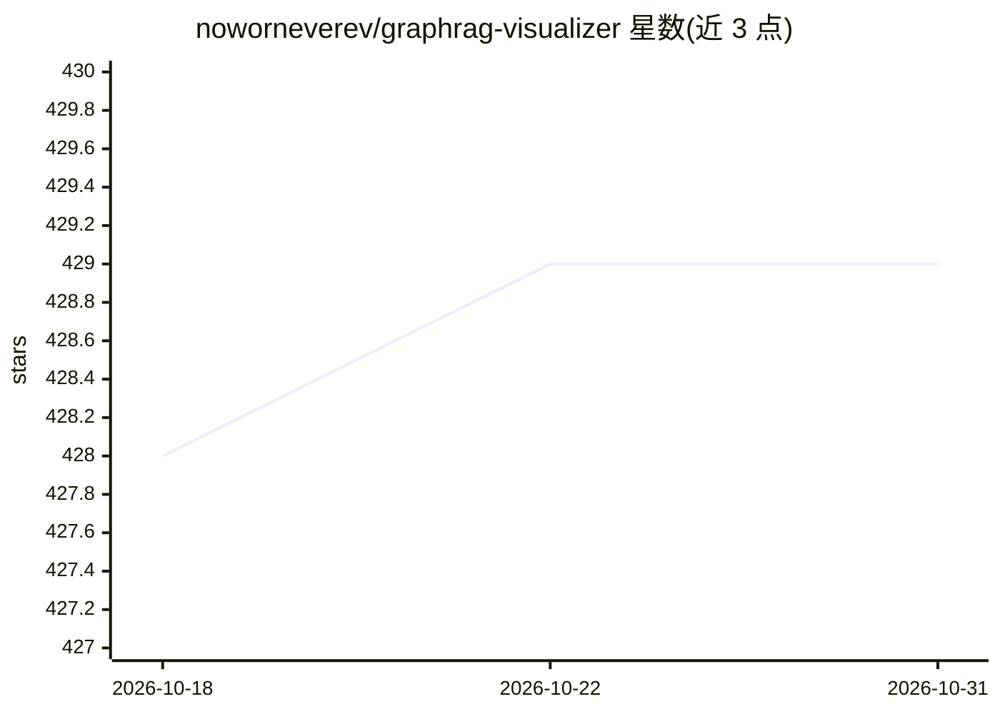

# noworneverev/graphrag-visualizer

⭐ 429 · TypeScript · MIT · 推送 2026-02-25 · [GitHub](https://github.com/noworneverev/graphrag-visualizer) · [官网](https://noworneverev.github.io/graphrag-visualizer/) · 个人维护

**可视化探索 Microsoft GraphRAG 产物的网页工具**

面向使用 Microsoft GraphRAG 的用户：上传索引管道生成的 parquet 文件后，可在浏览器中以 2D/3D 查看实体关系图、以表格浏览数据并检索聚焦节点。所有文件在本地处理，无需额外软件或脚本；也可连接本地 graphrag-api 服务执行搜索查询。支持 GraphRAG v1/v2 两种目录结构，0.3.x 及以下版本需改用旧版。以 React 项目源码方式提供，git clone 后 npm install、npm start 运行。

## 筛选速览

| 维度 | 判定 | 备注 |
|---|---|---|
| AI 角色 | `ai-ecosystem` | LLM/agent 周边工具 |
| 许可风险 | `permissive` | MIT |
| 部署形态 | `library` | 以包/库形式分发 |
| 模型依赖 | — | README 未给出锁定关系 |
| 硬件要求 | — | 无带数字的原话,不猜 |
| 安装摩擦 | `low` | 无编译、无系统依赖或容器化 |
| 成熟度 | — | 结构信号不足 |

## 能力要点

- 上传 parquet 文件以 2D/3D 可视化 GraphRAG 图结构
- 支持针对节点与关系的搜索聚焦
- 所有产物在本地处理，不经外部服务
- 可对接本地 graphrag-api 服务执行查询

## 适用场景

- 在浏览器中查看 GraphRAG 索引产出的实体关系图
- 通过表格检查 GraphRAG 生成的 parquet 数据
- 连接本地 graphrag-api 对知识图谱做搜索探索

## 场景标签

`知识图谱` · 领域:知识与检索

## 证据(README 行号)

> L10: GraphRAG Visualizer is an application designed to visualize Microsoft GraphRAG artifacts. By uploading parquet file
> L26: Once the graphrag-api server is up and running, you can perform searches directly through the GraphRAG Visualizer. 

## 星数曲线

2026-10-18 428 → 2026-10-31 429（+1）

---
*卡片 v1 · prompt 1.4 · 生成 2026-10-21 · 置信度 high · 依据 README sha `4e2618033603` · [字段定义](../../DATASET.md)*
