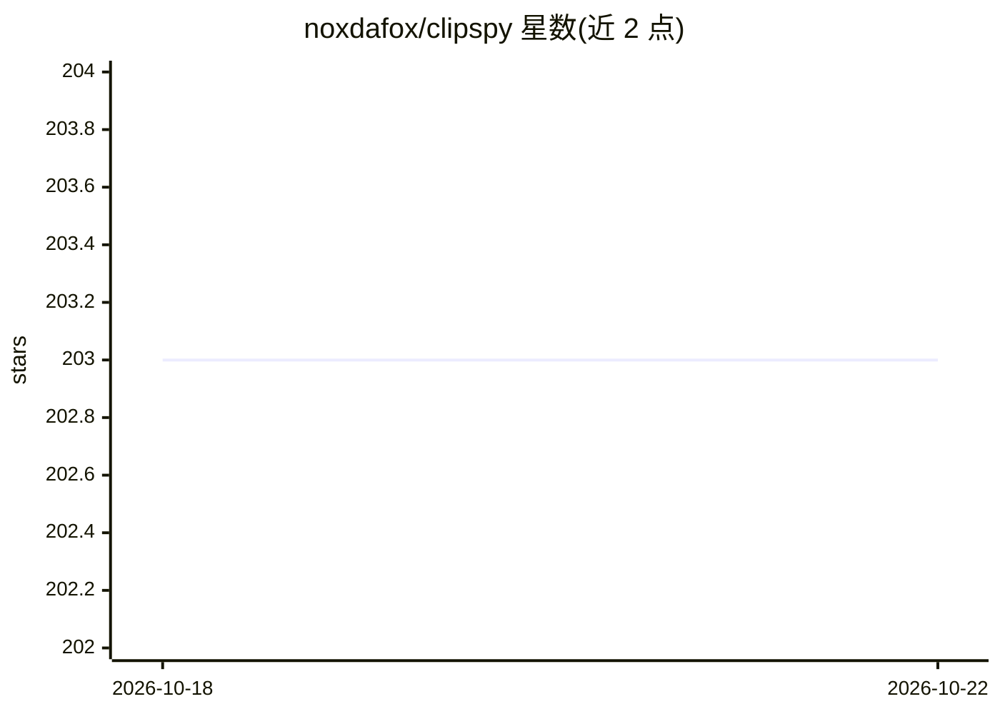

# noxdafox/clipspy

⭐ — · [GitHub]() · 个人维护

**面向 Python 开发者的 CLIPS 专家系统 CFFI 绑定库**

通过 CFFI 将 NASA 约翰逊航天中心最初开发的规则式编程语言 CLIPS 6.42 接入 Python 生态，用于构建专家系统与生产系统。提供 Environment 对象加载 deftemplate/defrule 构造、断言事实、访问事实槽位并执行议程中的激活，适合启发式方案比命令式更易维护的知识建模场景。以 pip wheel 形式分发（Linux x86_64/aarch64、Apple Intel 与 Silicon、Windows），Python 最低 3.9，也可经 Makefile 拉取 CLIPS 源码自行编译。

## 筛选速览

| 维度 | 判定 | 备注 |
|---|---|---|
| AI 角色 | `ai-ecosystem` | LLM/agent 周边工具 |
| 许可风险 | `permissive` | — |
| 部署形态 | `library` | 以包/库形式分发 |
| 模型依赖 | — | README 未给出锁定关系 |
| 硬件要求 | — | 无带数字的原话,不猜 |
| 安装摩擦 | `medium` | 含编译或系统依赖之一 |
| 成熟度 | — | 结构信号不足 |

## 能力要点

- CFFI 绑定 CLIPS 6.42 规则引擎，可在 Python 中定义模板、规则与事实
- 提供 Linux/macOS/Windows 的 pip wheel，最低 Python 3.9
- 支持 Makefile 从源码构建（自动获取并编译 CLIPS 源码）

## 适用场景

- 在 Python 项目中嵌入规则式推理构建专家系统
- 用规则引擎建模领域知识替代命令式逻辑
- 复用既有 CLIPS 规则体系于 Python 生态

## 场景标签

 · 领域:知识工程/专家系统

## 证据(README 行号)

> L3: Python CFFI_ bindings for the 'C' Language Integrated Production System CLIPS_ 6.42.
> L20: CLIPSPy brings CLIPS capabilities within the Python ecosystem.

## 星数曲线

2026-10-18 203 → 2026-10-22 203（+0）

---
*卡片 v1 · prompt 1.4 · 生成 2026-10-22 · 置信度 high · 依据 README sha `ef6b5fc16dcc` · [字段定义](../../DATASET.md)*
