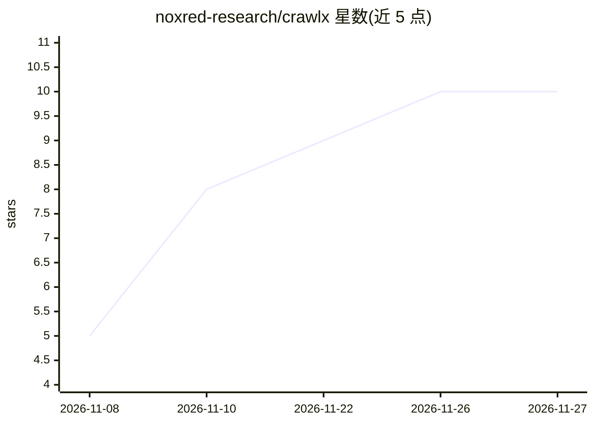

# noxred-research/crawlx

⭐ 10 · Rust · AGPL-3.0 · 推送 2026-11-23 · [GitHub](https://github.com/noxred-research/crawlx) · 组织维护

**为授权安全测试映射动态 Web 应用攻击面的 AI 爬虫**

面向自有或书面授权系统的 Rust 爬虫，映射动态 Web 应用攻击面：通过 Chromium/CDP 与可访问性树发现单页应用的路由、端点、表单与页面状态，输出 JSONL、Markdown、WARC 等格式。内置授权记录、硬安全内核（默认 read_only 拒绝改状态）、SSRF 出口策略与审计日志；LLM 规划/排序功能默认关闭，模型只建议不授权。仅发布源码，pre-1.0 阶段。

## 筛选速览

| 维度 | 判定 | 备注 |
|---|---|---|
| AI 角色 | `ai-ecosystem` | LLM/agent 周边工具 |
| 许可风险 | `viral` | AGPL-3.0 |
| 部署形态 | `self-host` | docker 或自建部署 |
| 模型依赖 | — | README 未给出锁定关系 |
| 硬件要求 | — | 无带数字的原话,不猜 |
| 安装摩擦 | `low` | 无编译、无系统依赖或容器化 |
| 成熟度 | `idea` | |

## 能力要点

- 静态/动态/混合三种模式，混合模式读取可访问性树并聚类页面状态
- 授权记录+硬安全内核+SSRF 出口策略+按源限速的结构化防护
- 九类 secret 检测（只报类型、位置与哈希，不存值）
- MCP server 与 chat-completions 兼容接口供 agent 工具调用

## 适用场景

- 对自有或授权的 SPA 应用做攻击面测绘
- 在受限配置下做只读动态爬取与端点发现
- 爬取结果接入 agent 工具链（MCP）做提取与检索

## 场景标签

`网页抓取` `网络安全` · 领域:效率与自动化

## 证据(README 行号)

> L1: CrawlX: next-generation AI/LLM-native crawler for authorized security research
> L35: - **It is AI/LLM-native, with a leash.** Models can plan and rank; they never authorize.
> L82: |🧠 **AI/LLM-native**|A constrained LLM planner, a typed-decision service and an ONNX ranker, LLM-assisted form valu

## 星数曲线

2026-11-08 5 → 2026-11-27 10（+5）

---
*卡片 v1 · prompt 1.4 · 生成 2026-11-20 · 置信度 mid · 依据 README sha `99bfdf5111dd` · [字段定义](../../DATASET.md)*
