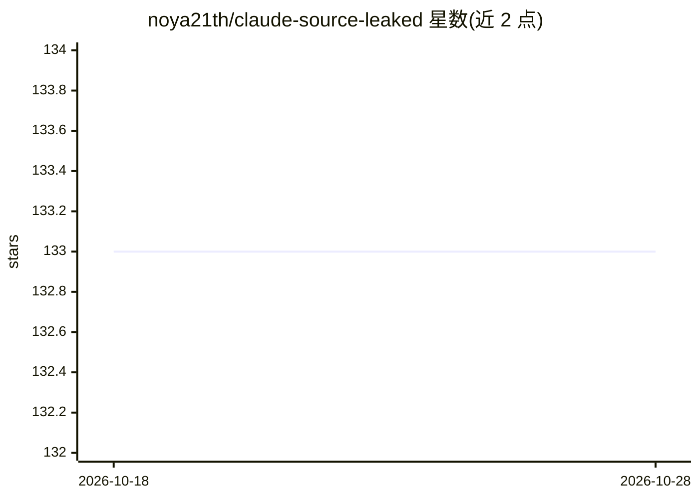

# noya21th/claude-source-leaked

⭐ 133 · TypeScript · NOASSERTION · 推送 2026-03-31 · [GitHub](https://github.com/noya21th/claude-source-leaked) · 个人维护 · 中文 README

**Claude Code v2.1.88 源码逆向分析文档：架构、隐藏功能与成本优化**

基于 Claude Code v2.1.88 未混淆源码（1,884 个文件、约 132K 行 TypeScript）的逆向分析知识库：重建完整系统提示词与 5 层优先级机制，编目 87 个编译期隐藏功能开关（KAIROS/PROACTIVE/BUDDY 等）、15 个隐藏斜杠命令、25 个内部命令与 Undercover 模式，梳理成本优化技巧与定价阈值，绘制请求生命周期、工具权限与多 Agent 架构图，并附与 Cursor/Cline 的功能对比及遥测数据采集说明。全部结论附源码文件与行号引用。面向关注 Claude Code 内部实现的开发者与研究者，为文档型仓库，不含本产品安装运行流程。

## 筛选速览

| 维度 | 判定 | 备注 |
|---|---|---|
| AI 角色 | `ai-knowledge` | 知识聚合/清单类 |
| 许可风险 | `none` | NOASSERTION |
| 部署形态 | `None` |  |
| 模型依赖 | — | README 未给出锁定关系 |
| 硬件要求 | — | 无带数字的原话,不猜 |
| 安装摩擦 | `low` | 无编译、无系统依赖或容器化 |
| 成熟度 | — | 结构信号不足 |

## 能力要点

- 完整重建系统提示词（9 大节）与静态/动态缓存边界机制
- 编目 87 个隐藏功能开关、15 个隐藏命令、25 个内部命令
- 10 条成本优化技巧，均附源码文件与行号证据
- Claude Code/Cursor/Cline 三方功能对比矩阵与遥测渠道分析

## 适用场景

- 了解 Claude Code 的系统提示词与优先级机制设计
- 查找降低 Claude Code 使用成本的配置方法
- 对比 Claude Code 与 Cursor/Cline 决定编码工具选型
- 研究闭源 AI 编码工具的隐藏功能与遥测行为

## 场景标签

`提示工程` · 领域:Agent 开发

## 证据(README 行号)

> L3: **The first architecture deep-dive, hidden feature catalog, and cost optimization guide for Claude Code — based on v
> L7: > On March 31, 2026, Claude Code's TypeScript source (1,884 files, ~132K lines) was exposed through an unstripped `.

## 星数曲线

2026-10-18 133 → 2026-10-28 133（+0）

---
*卡片 v1 · prompt 1.4 · 生成 2026-10-22 · 置信度 high · 依据 README sha `800407658f71` · [字段定义](../../DATASET.md)*
