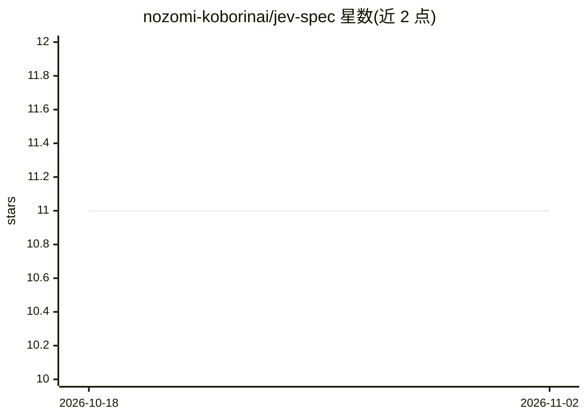

# nozomi-koborinai/jev-spec

⭐ 11 · TypeScript · MIT · 推送 2026-09-29 · [GitHub](https://github.com/nozomi-koborinai/jev-spec) · [官网](https://koborin.ai/tech/jev-spec-introduction) · 个人维护 · 中文 README

**对照 Markdown 规格检查代码漂移的 CI/pre-commit 门禁工具**

面向开发者的规格漂移检查 CLI：在 jev-spec.config.ts 中为每条需求写一个类型化问题（noul/choice/score），调用 TypeSafe AI 的 Jev 模型返回校准概率或分数，与阈值比较后按退出码 0/1/2 决定构建通过与否。设计上每 commit 可承担（仅按输入 token 计费），并做根目录隔离、symlink 检查等安全处理。真实检查需 TypeSafe API key，无 key 可 --dry-run/--mock；限制包括单目标 ≤500 文件、英文最准确、规格中的表格暂不发送。

## 筛选速览

| 维度 | 判定 | 备注 |
|---|---|---|
| AI 角色 | `ai-ecosystem` | LLM/agent 周边工具 |
| 许可风险 | `permissive` | MIT |
| 部署形态 | `library` | 以包/库形式分发 |
| 模型依赖 | — | README 未给出锁定关系 |
| 硬件要求 | — | 无带数字的原话,不猜 |
| 安装摩擦 | `low` | 无编译、无系统依赖或容器化 |
| 成熟度 | — | 结构信号不足 |

## 能力要点

- 按需求提问并返回校准概率，以数值阈值与退出码门禁构建
- 支持 noul（布尔）/choice（分类）/score（等级）三类 rubric
- pre-commit（--staged/--diff）与 CI 阻断检查两种使用方式
- 提供 Agent Skills（jev-spec-init/fix）辅助初始化与修复

## 适用场景

- 在 pre-commit 或 CI 中检测代码与 Markdown 规格的漂移
- AI 辅助开发中核查助手是否悄悄引入未规定的改动
- 判断 PR 是完整实现还是带乐观注释的桩代码

## 场景标签

`代码审查` · 领域:编码与开发

## 证据(README 行号)

> L14: **Catch spec drift on every commit.** `jev-spec` checks your code against the requirements in your Markdown specifi
> L40: 2. **Jev answers with numbers.** Jev is a System One model: it does not generate text. It reads the specification a

## 星数曲线

2026-10-18 11 → 2026-11-02 11（+0）

---
*卡片 v1 · prompt 1.4 · 生成 2026-11-01 · 置信度 high · 依据 README sha `25ae50672c90` · [字段定义](../../DATASET.md)*
