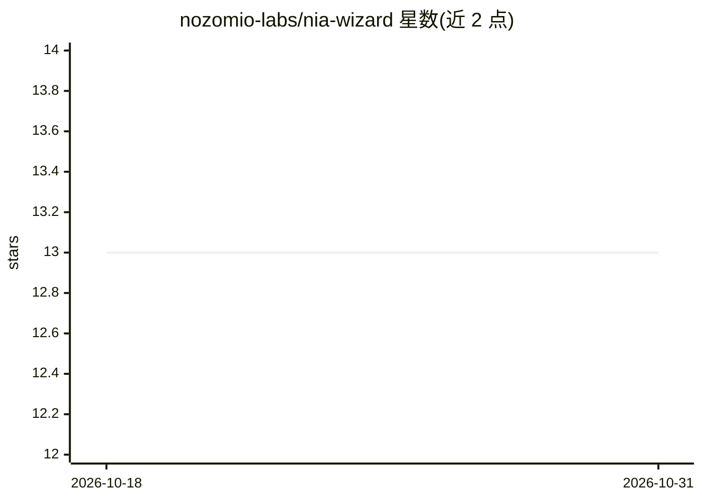

# nozomio-labs/nia-wizard

⭐ 13 · TypeScript · 推送 2026-04-22 · [GitHub](https://github.com/nozomio-labs/nia-wizard) · [官网](https://www.trynia.ai/) · 组织维护

**60 秒安装 Nia 到各类编程 Agent 的 CLI 向导**

面向使用 Nia 的开发者的命令行安装向导：通过 curl 一键脚本或 npx 运行，完成浏览器/API key 认证、安装依赖与 nia-cli，并把 Nia MCP 服务器配置写入检测到的编程 Agent（Cursor、VS Code、Claude Code、Copilot 等 30 余种），支持本地模式（pipx 运行）与远程云模式。提供 skill 安装、--agent 向外部 Agent 输出安装步骤提示、--ci 非交互模式等选项。MIT 许可。

## 筛选速览

| 维度 | 判定 | 备注 |
|---|---|---|
| AI 角色 | `ai-ecosystem` | LLM/agent 周边工具 |
| 许可风险 | `none` | — |
| 部署形态 | `library` | 以包/库形式分发 |
| 模型依赖 | — | README 未给出锁定关系 |
| 硬件要求 | — | 无带数字的原话,不猜 |
| 安装摩擦 | `low` | 无编译、无系统依赖或容器化 |
| 成熟度 | — | 结构信号不足 |

## 能力要点

- 一键脚本自动安装 Node.js 并配置编程 Agent
- 支持 30 余种编程 Agent 的 MCP 服务器配置注入
- 本地模式（pipx）与远程云模式两种运行方式
- 支持 skill 安装与非交互 CI 模式

## 适用场景

- 快速把 Nia MCP 接入我常用的编程 Agent
- CI 环境中非交互完成 Nia skill 安装
- 让外部 coding agent 代替我执行 Nia CLI 安装步骤

## 场景标签

 · 领域:AI 开发者工具/MCP 生态

## 证据(README 行号)

> L3: CLI wizard to install Nia to your coding agents via Nia CLI, Skills, or direct agent setup.
> L230: The wizard detects which coding agents are installed on your system and adds the Nia MCP server configuration to e

## 星数曲线

2026-10-18 13 → 2026-10-31 13（+0）

---
*卡片 v1 · prompt 1.4 · 生成 2026-10-31 · 置信度 high · 依据 README sha `cffbd67da80e` · [字段定义](../../DATASET.md)*
