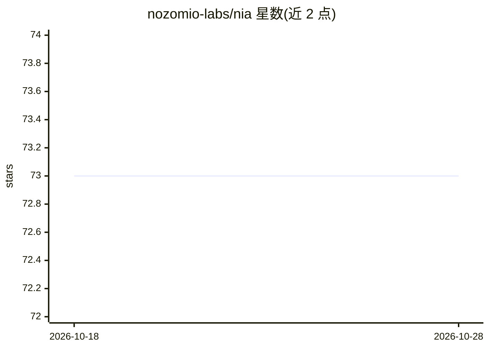

# nozomio-labs/nia

⭐ 73 · MIT · 推送 2026-04-06 · [GitHub](https://github.com/nozomio-labs/nia) · [官网](https://www.trynia.ai/) · 组织维护

**给编码 agent 的上下文增强 API/MCP 服务：索引多源资料供 AI 检索**

Nozomio Labs（Y Combinator 支持）开发的 API 层产品：将 GitHub 仓库、文档站、PDF、arXiv 论文、HuggingFace 数据集、表格、Google Drive、Slack、本地文件夹等来源索引并自动同步，向 AI agent 提供语义搜索 API；另含 Document Agent 深度文档研究、PDF 结构化数据抽取、GitHub 代码免索引搜索（Tracer）、Oracle 深度研究、跨 agent 上下文共享等能力。可通过 npx 向导接入 Cursor、Claude Code 等 30+ agent，也可用 Nia API 自建应用。采用订阅+积分付费模式（免费档 50 欀查询/月），企业版提供 SOC-2 与自托管。

## 筛选速览

| 维度 | 判定 | 备注 |
|---|---|---|
| AI 角色 | `ai-ecosystem` | LLM/agent 周边工具 |
| 许可风险 | `permissive` | MIT |
| 部署形态 | `library` | 以包/库形式分发 |
| 模型依赖 | — | README 未给出锁定关系 |
| 硬件要求 | — | 无带数字的原话,不猜 |
| 安装摩擦 | `low` | 无编译、无系统依赖或容器化 |
| 成熟度 | — | 结构信号不足 |

## 能力要点

- 索引仓库/文档/PDF/数据集/Drive/Slack 等并自动同步，提供搜索 API
- 免索引搜索 PyPI/NPM/Crates.io/Go 的 1.5 亿+ 预索引文档
- Document Agent 对已索引 PDF 做带引用的自主研究；PDF 按 schema 抽取为 JSON
- 以 API 或 MCP server 形式供 30+ agent（Cursor、Claude Code 等）接入

## 适用场景

- 为我的编码 agent 提供最新的文档和代码库上下文，减少编造
- 对法律 PDF、论文、博客等资料建索引做问答或研究
- 从财务报表、发票等 PDF 抽取结构化 JSON 数据

## 场景标签

`语义搜索` `文档解析` · 领域:知识与检索

## 证据(README 行号)

> L14: Nia is an **API layer** that gives agents up-to-date, continuously monitored context across repositories, documenta
> L16: You can use it with agents like Cursor or Claude Code as an MCP server, or build your own applications with the Nia
> L35: - **API & MCP** - Available as an API or MCP server for any agent

## 星数曲线

2026-10-18 73 → 2026-10-28 73（+0）

---
*卡片 v1 · prompt 1.4 · 生成 2026-10-24 · 置信度 mid · 依据 README sha `cda4da069567` · [字段定义](../../DATASET.md)*
