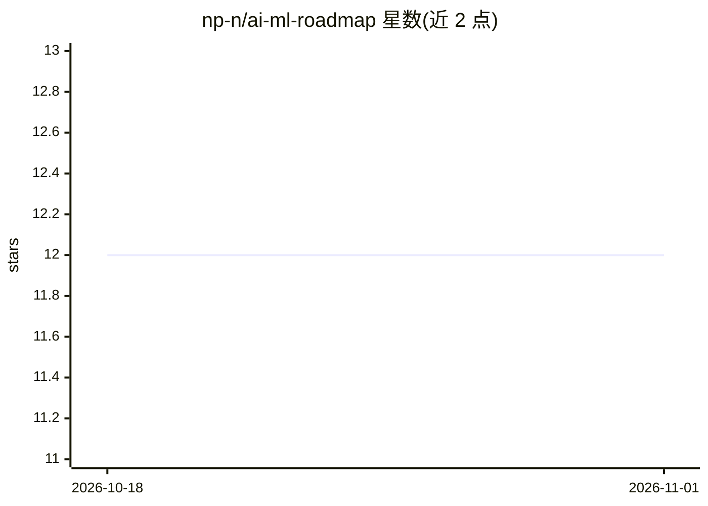

# np-n/ai-ml-roadmap

⭐ 12 · MIT · 推送 2026-06-28 · [GitHub](https://github.com/np-n/ai-ml-roadmap) · 个人维护

**面向初学者的 AI/ML 学习路线资源清单（Python 到 GenAI）**

社区维护的学习资源策展清单，按模块组织：Python 编程、数据基础（NumPy/Pandas/可视化）、数据预处理、数学基础（线代/统计/概率）、ML 基础与核心概念、数据库与工程基础（SQL/Git/API/Docker）、深度学习，主题标签还覆盖 NLP、计算机视觉与生成式 AI。条目按 Beginner→Intermediate→Advanced 排序，用图标区分 YouTube 视频、文章、官方文档、免费/付费课程。来源为 Medium 上的 AI/ML Roadmap for Beginners 2026，MIT 许可，接受社区贡献。

## 筛选速览

| 维度 | 判定 | 备注 |
|---|---|---|
| AI 角色 | `ai-knowledge` | 知识聚合/清单类 |
| 许可风险 | `permissive` | MIT |
| 部署形态 | `None` |  |
| 模型依赖 | — | README 未给出锁定关系 |
| 硬件要求 | — | 无带数字的原话,不猜 |
| 安装摩擦 | `low` | 无编译、无系统依赖或容器化 |
| 成熟度 | — | 结构信号不足 |

## 能力要点

- 按 8+ 模块覆盖 Python、数据、数学、ML、DL 到 GenAI 的学习路径
- 每主题内资源按 Beginner→Intermediate→Advanced 分级
- 图标区分视频/文章/文档/免费课程/付费课程五类资源
- MIT 许可并开放社区贡献

## 适用场景

- 按路线图从零开始自学 AI/ML
- 查找某个具体主题（如特征缩放、交叉验证）的分级学习资源
- 为课程设计或培训挑选参考资料

## 场景标签

`精选清单` · 领域:学习与行业

## 证据(README 行号)

> L7: > A curated, community-maintained collection of the **best free and paid resources** to learn every topic in the AI/
> L27: ## Table of Contents

## 星数曲线

2026-10-18 12 → 2026-11-01 12（+0）

---
*卡片 v1 · prompt 1.4 · 生成 2026-11-01 · 置信度 high · 依据 README sha `5ea33a0195ae` · [字段定义](../../DATASET.md)*
