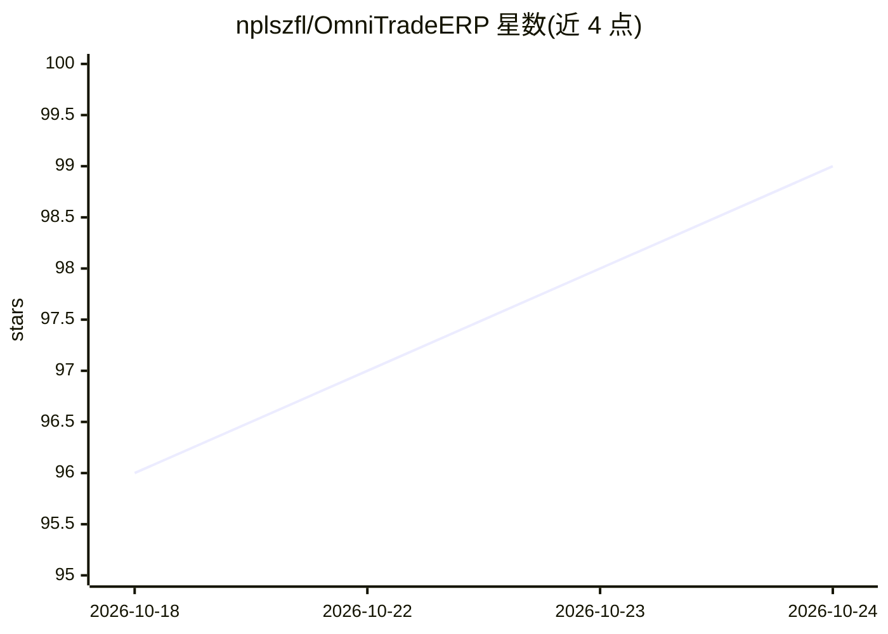

# nplszfl/OmniTradeERP

⭐ 100 · Java · 推送 2026-09-24 · [GitHub](https://github.com/nplszfl/OmniTradeERP) · 个人维护 · 中文 README

**跨境电商 ERP：多平台订单/库存/客服管理并带 AI 定价与预测**

基于 Java 21 + Spring Cloud 微服务与 Vue 3 前端的开源跨境电商 ERP 系统，支持 Amazon、eBay、Shopee、Lazada、TikTok Shop 等平台的后台统一管理，涵盖订单、库存、采购、报表等模块。AI 功能包括智能定价（竞品抓取+动态调价）、Prophet/ARIMA 库存预测、RAG 知识库+LLM 多语言客服（需配置 DeepSeek/OpenAI API Key）、产品描述生成与订单异常检测。提供 Docker Compose 与 K8s 部署方式，MIT 协议。

## 筛选速览

| 维度 | 判定 | 备注 |
|---|---|---|
| AI 角色 | `ai-enhanced` | 去掉 AI 部分产品仍成立 |
| 许可风险 | `none` | — |
| 部署形态 | `self-host` | docker 或自建部署 |
| 模型依赖 | — | README 未给出锁定关系 |
| 硬件要求 | — | 无带数字的原话,不猜 |
| 安装摩擦 | `low` | 无编译、无系统依赖或容器化 |
| 成熟度 | — | 结构信号不足 |

## 能力要点

- 10+ 跨境电商平台统一后台管理
- AI 智能定价：竞品价格抓取 + 季节性因子动态调整
- Prophet/ARIMA 库存预测与补货建议
- RAG 知识库 + LLM 多语言 AI 客服

## 适用场景

- 跨境卖家在一个后台管理多平台店铺订单与库存
- 根据竞品价格与季节因素自动调整商品定价
- 用 AI 客服多语言自动回复买家咨询
- 基于销售历史生成补货与采购建议

## 场景标签

`聊天机器人` · 领域:对话与助手

## 证据(README 行号)

> L24: |📊 **每天手动调价累死人**|🤖 AI智能定价 - 实时监控竞品，自动优化价格，利润提升15%+|
> L26: |💬 **外语客服头痛**|🌍 AI客服支持多语言，RAG知识库+LLM，7×24小时自动回复|

## 星数曲线

2026-10-18 96 → 2026-10-24 99（+3）

---
*卡片 v1 · prompt 1.4 · 生成 2026-10-23 · 置信度 high · 依据 README sha `56c33cb0b11a` · [字段定义](../../DATASET.md)*
