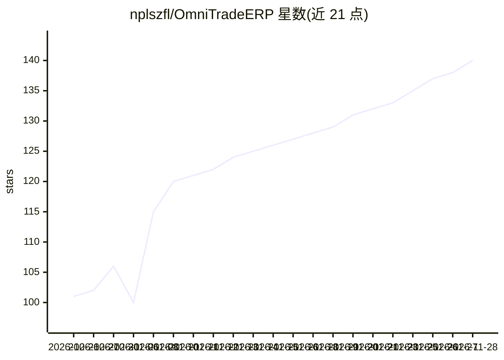

# nplszfl/OmniTradeERP

⭐ 140 · Java · 推送 2026-11-27 · [GitHub](https://github.com/nplszfl/OmniTradeERP) · 个人维护 · 中文 README

**跨境电商ERP：多平台订单管理+AI定价/客服/预测**

基于 Java 21 + Spring Cloud 微服务（Nacos/Sentinel/Gateway）+ Vue 3 的跨境电商 ERP，提供订单、库存、采购、报表等模块，对接 Amazon、eBay、Shopee、Lazada、TikTok Shop 等平台（另有 Temu、速卖通等预留）。AI 相关功能包括：基于 LLM（DeepSeek/OpenAI API Key）的智能定价与多语言 AI 客服（RAG 知识库）、AI 产品描述生成、AI 订单异常检测、选品推荐服务；库存预测为移动平均+趋势+季节性因子的启发式方法，README 注明非机器学习模型。README 中多项收益数字标注为未在生产环境验证的目标值。

## 筛选速览

| 维度 | 判定 | 备注 |
|---|---|---|
| AI 角色 | `ai-enhanced` | 去掉 AI 部分产品仍成立 |
| 许可风险 | `none` | — |
| 部署形态 | `self-host` | docker 或自建部署 |
| 模型依赖 | — | README 未给出锁定关系 |
| 硬件要求 | — | 无带数字的原话,不猜 |
| 安装摩擦 | `low` | 无编译、无系统依赖或容器化 |
| 成熟度 | — | 结构信号不足 |

## 能力要点

- AI 智能定价：抓取竞品价格，成本加成+利润率自动计算，支持手动/自动模式
- AI 客服：RAG 知识库 + LLM（DeepSeek/OpenAI），多语言、意图识别、流式输出
- 9 大 AI 服务：含订单异常检测（规则+评分双层）、选品推荐、描述生成
- Docker Compose 一键启动与 Kubernetes 部署脚本

## 适用场景

- 一个后台管理 Amazon/eBay/Shopee 等多平台店铺订单与库存
- 用 AI 自动调价并监控竞品价格
- 搭建多语言 AI 客服自动回复买家咨询
- 生成 SEO 产品描述与采购补货建议

## 场景标签

`RAG` `聊天机器人` · 领域:对话与助手

## 证据(README 行号)

> L26: |💬 **外语客服头痛**|🌍 AI客服支持多语言，RAG知识库+LLM，7×24小时自动回复|
> L128: |🔹 JDK|Java|21 (虚拟线程)|
> L309: **Q: AI功能怎么开启？**

## 星数曲线

2026-10-26 101 → 2026-11-28 140（+39）

---
*卡片 v1 · prompt 1.4 · 生成 2026-11-27 · 置信度 high · 依据 README sha `8cbf13943134` · [字段定义](../../DATASET.md)*
