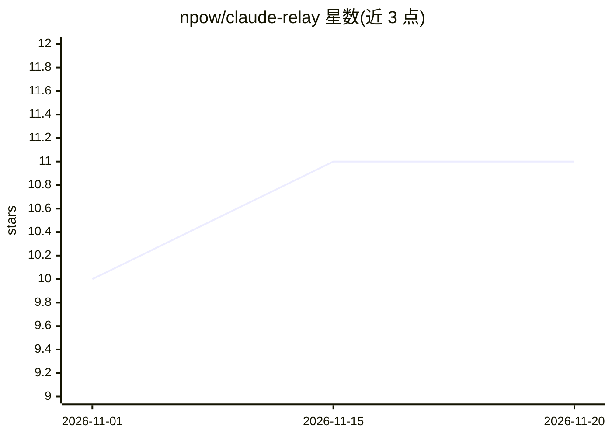

# npow/claude-relay

⭐ 11 · Python · MIT · 推送 2026-05-09 · [GitHub](https://github.com/npow/claude-relay) · 个人维护

**将 OpenAI/Anthropic API 请求转发给 Claude Code CLI 的代理服务器**

以本地服务形式提供与 OpenAI 和 Anthropic 兼容的 API 端点，每个请求在底层生成为 `claude -p` 进程并在两种协议间进行转换。支持流式输出、多轮会话、真实 token 计数、基于本地 Ollama 分类器的按复杂度路由，以及包含请求日志、Sentry/Better Stack 集成和 Grafana/Loki 日志转发功能。安装方式：uv/PyPI，可在 macOS 上通过 launchd 后台运行。限制：采样参数被忽略，不透传 tool calling，每请求产生约 2-3 秒的进程开销，不支持图片/音频转发。

## 筛选速览

| 维度 | 判定 | 备注 |
|---|---|---|
| AI 角色 | `ai-ecosystem` | LLM/agent 周边工具 |
| 许可风险 | `permissive` | MIT |
| 部署形态 | `library` | 以包/库形式分发 |
| 模型依赖 | local-ok | 支持本地模型 |
| 硬件要求 | — | 无带数字的原话,不猜 |
| 安装摩擦 | `low` | 无编译、无系统依赖或容器化 |
| 成熟度 | — | 结构信号不足 |

## 能力要点

- 提供 OpenAI 与 Anthropic 两种格式的兼容端点（/v1/chat/completions、/v1/messages 等）
- 每请求生成 claude -p 进程，保留 Claude Code 的工具调用与 MCP 能力
- 基于本地 Ollama 分类器的 SIMPLE/MEDIUM/COMPLEX/REASONING 四档模型路由
- 内置请求日志、/metrics 计数器及 Sentry/Better Stack/Grafana 可观测性集成

## 适用场景

- 让 Cursor、Continue、aider 等 OpenAI 客户端使用 Claude Code
- 将 LangChain 应用接入 Claude Code 的工具与 MCP 能力
- 按提示词复杂度自动在 haiku/sonnet/opus 间分配请求
- 对经过中转的 API 请求做日志与监控

## 场景标签

`模型网关` · 领域:Agent 开发

## 证据(README 行号)

> L8: Drop-in OpenAI **and Anthropic** API server that routes through agent CLIs (currently Claude Code).
> L14: You have tools that speak the OpenAI or Anthropic API. You have Claude Code with its tools, MCP servers, and agenti
> L275:                     ├→  claude-relay  →  claude -p  →  Anthropic API

## 星数曲线

2026-11-01 10 → 2026-11-20 11（+1）

---
*卡片 v1 · prompt 1.4 · 生成 2026-11-18 · 置信度 high · 依据 README sha `7d63509b3c9c` · [字段定义](../../DATASET.md)*
