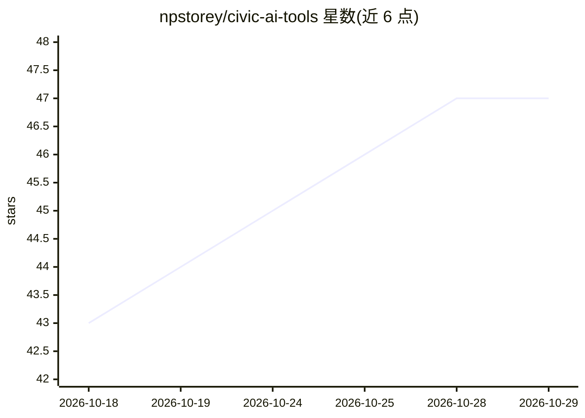

# npstorey/civic-ai-tools

⭐ 47 · TypeScript · MIT · 推送 2026-10-28 · [GitHub](https://github.com/npstorey/civic-ai-tools) · [官网](https://civicaitools.org) · 个人维护

**通过 MCP 把 AI 助手接入政府开放数据的平台**

面向公民技术人士、政府工作人员、记者与学生的开源平台：用 Model Context Protocol 把 GitHub Copilot、Cursor、Claude Code 等 AI 助手连接到 NYC Open Data（Socrata）与 Google Data Commons，以自然语言查询 311 投诉、餐厅检查、人口收入等数据集并生成可视化。仓库为本地起步套件，含两个 npm 包（civic-typed-harness、civic-typed-router）与 Typed Standards Specification（v0.1 工作草案，CC BY 4.0），使 AI 分析可检查、可复现、可密码学验证。代码 MIT 许可，声明为个人项目。

## 筛选速览

| 维度 | 判定 | 备注 |
|---|---|---|
| AI 角色 | `ai-ecosystem` | LLM/agent 周边工具 |
| 许可风险 | `permissive` | MIT |
| 部署形态 | `library` | 以包/库形式分发 |
| 模型依赖 | — | README 未给出锁定关系 |
| 硬件要求 | — | 无带数字的原话,不猜 |
| 安装摩擦 | `low` | 无编译、无系统依赖或容器化 |
| 成熟度 | `idea` | |

## 能力要点

- Socrata MCP 与 Data Commons MCP 两个数据接入服务
- GitHub Codespaces 一键启动，无需本地安装
- Typed Standards Specification v0.1 工作草案，面向可验证 AI 分析记录
- npm workspace 含 civic-typed-harness 与 civic-typed-router 两个包

## 适用场景

- 用自然语言查询 NYC 311 投诉、餐厅检查等公开数据
- 从 Google Data Commons 拉取人口、收入与人口统计指标
- 在 Copilot/Cursor/Claude Code 中对城市数据做对比分析与可视化

## 场景标签

`数据分析` · 领域:效率与自动化

## 证据(README 行号)

> L7: Civic AI Tools connects AI assistants (GitHub Copilot, Cursor, Claude Code) to public datasets using the Model Conte
> L64: |MCP Server|Data Source|What you can query|
> L101: - packages/civic-typed-harness publishes as `@typedstandards/civic-typed-harness` — the civic **domain** harness l

## 星数曲线

2026-10-18 43 → 2026-10-29 47（+4）

---
*卡片 v1 · prompt 1.4 · 生成 2026-10-25 · 置信度 mid · 依据 README sha `e09d04a6753b` · [字段定义](../../DATASET.md)*
