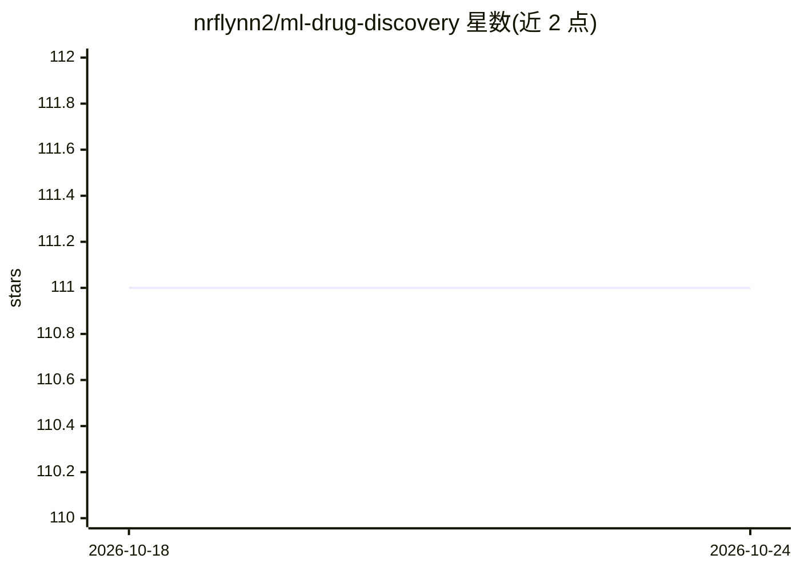

# nrflynn2/ml-drug-discovery

⭐ 111 · Jupyter Notebook · Apache-2.0 · 推送 2026-07-29 · [GitHub](https://github.com/nrflynn2/ml-drug-discovery) · [官网](https://www.manning.com/books/machine-learning-for-drug-discovery) · 个人维护

**《Machine Learning for Drug Discovery》图书配套代码与数据仓库**

Manning 出版书籍 Build AI Drug Discovery Pipelines 的官方配套仓库，提供各章节的可运行 Jupyter notebook 与数据，覆盖配体筛选、QSAR、溶解度建模、深度学习、GNN 靶点亲和力预测、蛋白质结构预测与端到端药物发现管线等主题。notebook 仅含代码块与节标题，需与图书正文对照阅读。代码以 Apache 2.0 发布。安装方式包括 Colab 免安装运行、uv 分层本地安装（Core/Advanced/Full），第 9 章另需 conda 安装 openmm/vina/pdbfixer。

## 筛选速览

| 维度 | 判定 | 备注 |
|---|---|---|
| AI 角色 | `ai-knowledge` | 知识聚合/清单类 |
| 许可风险 | `permissive` | Apache-2.0 |
| 部署形态 | `library` | 以包/库形式分发 |
| 模型依赖 | — | README 未给出锁定关系 |
| 硬件要求 | — | 无带数字的原话,不猜 |
| 安装摩擦 | `low` | 无编译、无系统依赖或容器化 |
| 成熟度 | — | 结构信号不足 |

## 能力要点

- 覆盖化学信息学、深度学习、GNN、蛋白质结构预测等 13 章+附录的配套 notebook
- Colab 免安装运行，每章 pip 安装所需包
- uv 分层安装（Core/Advanced/Full）按章节需求装依赖
- 第 9 章提供 conda 环境文件安装分子对接工具链

## 适用场景

- 随书学习机器学习在药物发现中的应用
- 在 Colab 上直接运行各章节示例代码
- 参考 QSAR、GNN、生成模型等药物发现代码实现

## 场景标签

`教程课程` · 领域:学习与行业

## 证据(README 行号)

> L5: This repository contains code and data for Build AI Drug Discovery Pipelines (Manning Publications). The companion m
> L13: #### 💊 Part 1: Fundamentals of Cheminformatics & Machine Learning

## 星数曲线

2026-10-18 111 → 2026-10-24 111（+0）

---
*卡片 v1 · prompt 1.4 · 生成 2026-10-23 · 置信度 high · 依据 README sha `60792a556007` · [字段定义](../../DATASET.md)*
