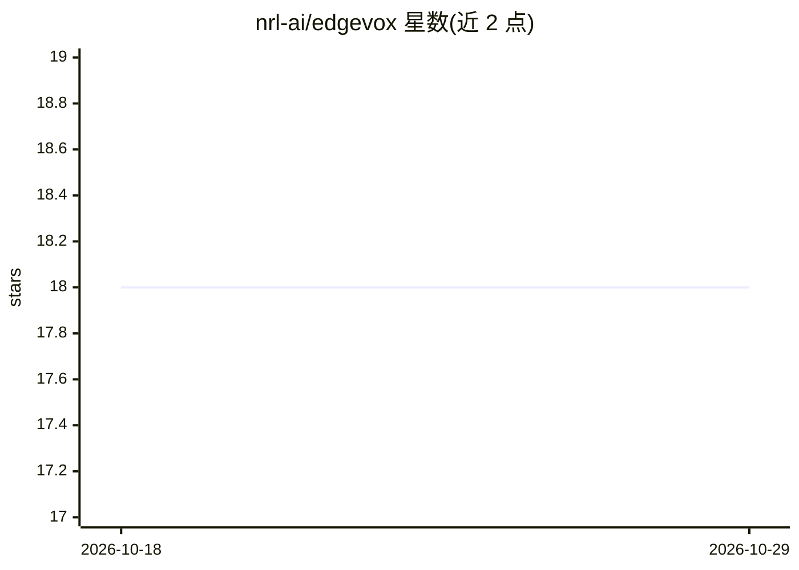

# nrl-ai/edgevox

⭐ 18 · Python · Apache-2.0 · 推送 2026-08-09 · [GitHub](https://github.com/nrl-ai/edgevox) · [官网](https://edgevox.nrl.ai) · 组织维护

**面向机器人和桌面应用的离线语音 agent 框架**

EdgeVox 提供本地运行的语音 agent 框架：用 Python 编写 @tool/@skill 函数，通过 Sequence/Fallback/Router 等工作流组合，运行流式 STT→LLM→TTS 语音管线（faster-whisper、llama.cpp 运行 Gemma、Kokoro/Piper 等 TTS），支持 16 种语言 56 种语音、VAD 插话打断与唤醒词。机器人侧提供 ROS2 桥接、SafetyMonitor 停止机制与三级仿真（stdlib/IR-SIM/MuJoCo），桌面侧可打包为单进程 PySide6 应用（RookApp 国际象棋机器人示例）。全部离线运行，无云端 API。硬件覆盖 CUDA/Metal/CPU，但亚秒首音频延迟为设计目标而非已测量数据（README 明确不发布未测数值）。

## 筛选速览

| 维度 | 判定 | 备注 |
|---|---|---|
| AI 角色 | `ai-ecosystem` | LLM/agent 周边工具 |
| 许可风险 | `permissive` | Apache-2.0 |
| 部署形态 | `library` | 以包/库形式分发 |
| 模型依赖 | — | README 未给出锁定关系 |
| 硬件要求 | `cpu-ok` | |
| 安装摩擦 | `medium` | 含编译或系统依赖之一 |
| 成熟度 | `idea` | |

## 能力要点

- 流式 STT→LLM→TTS 语音管线，支持插话打断与 4 个唤醒词，16 语言 56 语音
- @tool/@skill 装饰器 + 行为树形工作流（Sequence/Fallback/Router 等）的 agent 框架
- 三级仿真环境（ToyWorld/IR-SIM/MuJoCo）+ ROS2 桥接（TF2/Nav2/execute_skill action）
- 完全离线运行，无云端 API 与遥测；CUDA/Metal/CPU 自动检测回退

## 适用场景

- 用语音控制仿真或真实机器人（导航、抓取、人形行走）
- 构建完全本地化、隐私不出机的语音助手或桌面应用
- 通过 ROS2 驱动 Gazebo/Isaac 仿真或真实移动机器人

## 场景标签

`Agent 框架` `语音 Agent` · 领域:Agent 开发

## 证据(README 行号)

> L34: - **Agents are the program model** — write `@tool` and `@skill` functions in Python; compose them with `Sequence`, 
> L103: - **ROS2-native** — voice-pipeline bridge, TF2 / Nav2 / sensor adapter, `edgevox_msgs/action/ExecuteSkill` action 

## 星数曲线

2026-10-18 18 → 2026-10-29 18（+0）

---
*卡片 v1 · prompt 1.4 · 生成 2026-10-29 · 置信度 high · 依据 README sha `a00cad956268` · [字段定义](../../DATASET.md)*
