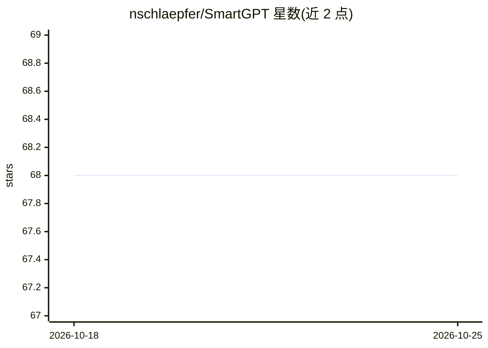

# nschlaepfer/SmartGPT

⭐ 68 · TypeScript · 推送 2026-01-22 · [GitHub](https://github.com/nschlaepfer/SmartGPT) · 个人维护

**TypeScript 双模型 AI agent 框架，可作库或 REST 服务器运行**

SmartGPT 是构建 AI agent 的 TypeScript 框架，采用推理模型与上下文模型分离的双模型管线，提供 ThoughtChain 多步推理、带内容抽取的网页搜索、Neo4j 或内存式记忆存储、可选 Memvid 后端及含 shell/文件访问的工具系统。所有模型调用通过 OpenAI Codex SDK 与 Claude Agent SDK 完成。可作库导入、REST 服务器（端口 4141，含 /api/ask 与 /mcp/invoke）或 stdio 模式的 MCP 服务器接入 Cursor IDE。

## 筛选速览

| 维度 | 判定 | 备注 |
|---|---|---|
| AI 角色 | `ai-ecosystem` | LLM/agent 周边工具 |
| 许可风险 | `none` | — |
| 部署形态 | `library` | 以包/库形式分发 |
| 模型依赖 | locked-api |  |
| 硬件要求 | — | 无带数字的原话,不猜 |
| 安装摩擦 | `low` | 无编译、无系统依赖或容器化 |
| 成熟度 | — | 结构信号不足 |

## 能力要点

- 推理模型与上下文模型分离的双模型管线
- Neo4j / 内存 / Memvid(.mv2) 三种记忆后端
- REST 服务器暴露 /api/ask 与 /mcp/invoke 端点
- Codex SDK 与 Claude Agent SDK 双通道模型调用

## 适用场景

- 在 TypeScript 项目中以库形式构建多步推理 agent
- 通过 REST 端点对外提供问答/agent 服务
- 作为 MCP 服务器接入 Cursor IDE 使用

## 场景标签

`Agent 框架` · 领域:Agent 开发

## 证据(README 行号)

> L3: SmartGPT is a TypeScript framework for building AI agents using a dual model pipeline. It can run as a library or as
> L7: - ThoughtChain multi-step reasoning

## 星数曲线

2026-10-18 68 → 2026-10-25 68（+0）

---
*卡片 v1 · prompt 1.4 · 生成 2026-10-24 · 置信度 high · 依据 README sha `f7cbd4a7fe32` · [字段定义](../../DATASET.md)*
