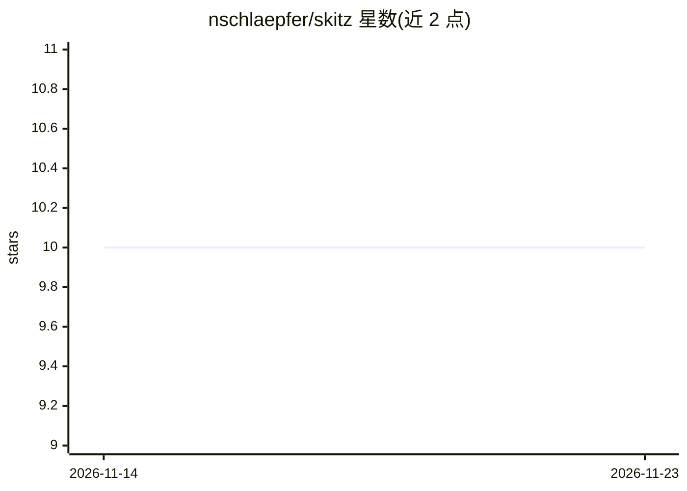

# nschlaepfer/skitz

⭐ 10 · Python · MIT · 推送 2026-11-22 · [GitHub](https://github.com/nschlaepfer/skitz) · 个人维护

**终端音乐 agent：创作可编辑乐谱并用 Suno 生成成曲**

在终端运行的 AI 音乐工具：接入 ChatGPT 订阅（OAuth 登录）或 Anthropic API key 作为模型后端，通过自然语言创作可编辑的乐谱（JSON schema 2，支持声部保护、平行五度校验修复、补丁式修改），并可渲染乐谱与音频。另支持在用户自己的 Suno 账号上生成成曲、下载文件并按 clip id 归档，以及在本地用 python-audio-separator 做分轨（Apple GPU）、basic-pitch 做旋律转录、切样叠加与混音导出。依赖 Python 3.11+、Node.js 22.8+、npm、uv；Suno 无公开 API，走网页会话私有端点，自动化可能与其条款冲突。

## 筛选速览

| 维度 | 判定 | 备注 |
|---|---|---|
| AI 角色 | `ai-native` | 本体是模型或模型工具 |
| 许可风险 | `permissive` | MIT |
| 部署形态 | `library` | 以包/库形式分发 |
| 模型依赖 | locked-api |  |
| 硬件要求 | — | 无带数字的原话,不猜 |
| 安装摩擦 | `medium` | 含编译或系统依赖之一 |
| 成熟度 | — | 结构信号不足 |

## 能力要点

- 可编辑乐谱创作：声部保护、修订保留、平行五度/八度校验修复
- Suno 歌曲生成与下载归档（按 clip id 匹配文件并写 manifest）
- 本地 GPU 分轨（BS-RoFormer SW、MDX23C DrumSep 等 preset）
- stem 转回可编辑乐谱（basic-pitch 转录，输出 MIDI 与 patch 记录）

## 适用场景

- 用自然语言创作并迭代修改四声部乐谱
- 用 Suno 生成成曲并整理下载文件与 BPM 信息
- 把歌曲分轨后将某条旋律转录为可编辑乐谱
- 切分采样、对齐 BPM/调性并导出到 Ableton Live 或 Logic Pro

## 场景标签

 · 领域:音乐创作/AI 应用

## 证据(README 行号)

> L3: A terminal music agent. Run it on your **ChatGPT subscription** or on **Claude**
> L63: uv run skitz create my-piece score.json --protect soprano
> L85: Skitz can also make finished songs on your own Suno account, for requests that

## 星数曲线

2026-11-14 10 → 2026-11-23 10（+0）

---
*卡片 v1 · prompt 1.4 · 生成 2026-11-19 · 置信度 high · 依据 README sha `a153864b268d` · [字段定义](../../DATASET.md)*
