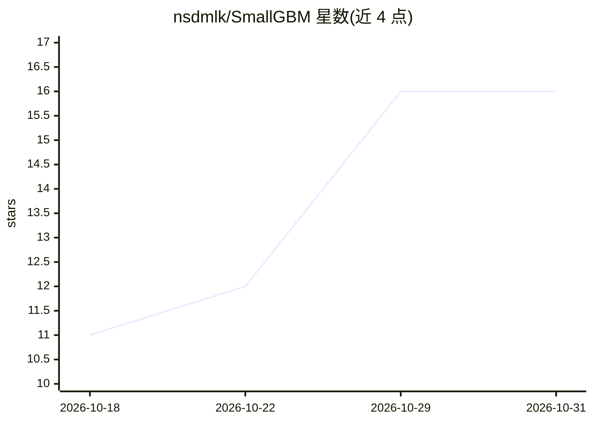

# nsdmlk/SmallGBM

⭐ 16 · Python · MIT · 推送 2026-10-07 · [GitHub](https://github.com/nsdmlk/SmallGBM) · [官网](https://nsdmlk.github.io/SmallGBM/) · 个人维护

**面向小数据集(n<1000)的梯度提升分类库**

SmallGBM 是专为小样本表格数据（n < 1000）设计的梯度提升库，提供 SmallGBMClassifier（scikit-learn 兼容接口）。核心机制：稳健叶权重（小叶取中位数、逆距离加权均值、向父节点自适应收缩）与随机分裂点选择（每特征 5 个随机阈值），以直方图（256 分位桶）C 实现决策树，经 ctypes 调用，pip 安装时自动编译。限制：回归未验证且不推荐；n > 1000 时在精度与速度上均劣于 XGBoost/LightGBM。需系统提供 C 编译器。

## 筛选速览

| 维度 | 判定 | 备注 |
|---|---|---|
| AI 角色 | `ai-native` | 本体是模型或模型工具 |
| 许可风险 | `permissive` | MIT |
| 部署形态 | `library` | 以包/库形式分发 |
| 模型依赖 | — | README 未给出锁定关系 |
| 硬件要求 | — | 无带数字的原话,不猜 |
| 安装摩擦 | `low` | 无编译、无系统依赖或容器化 |
| 成熟度 | — | 结构信号不足 |

## 能力要点

- 稳健叶权重：中位数/逆距离加权均值/自适应收缩
- C 核心：直方图分裂搜索，256 分位桶，安装时自动编译
- 随机阈值分裂与列子采样对抗小样本过拟合
- scikit-learn 兼容接口，含 predict_with_uncertainty()

## 适用场景

- 我在样本量不到一千条的分类任务上建模，不想调超参
- 小数据集存在离群点或标签噪声，需要稳健预测
- 需要预测不确定度估计的表格分类场景

## 场景标签

 · 领域:机器学习/表格数据

## 证据(README 行号)

> L17: SmallGBM is a gradient boosting library designed for **small datasets** (n < 1000). It combines robust leaf weight 
> L98: model.fit(X_train, y_train)
> L122: - **scikit-learn compatible** — `fit`, `predict`, `predict_proba`

## 星数曲线

2026-10-18 11 → 2026-10-31 16（+5）

---
*卡片 v1 · prompt 1.4 · 生成 2026-10-30 · 置信度 high · 依据 README sha `c72d61891c95` · [字段定义](../../DATASET.md)*
