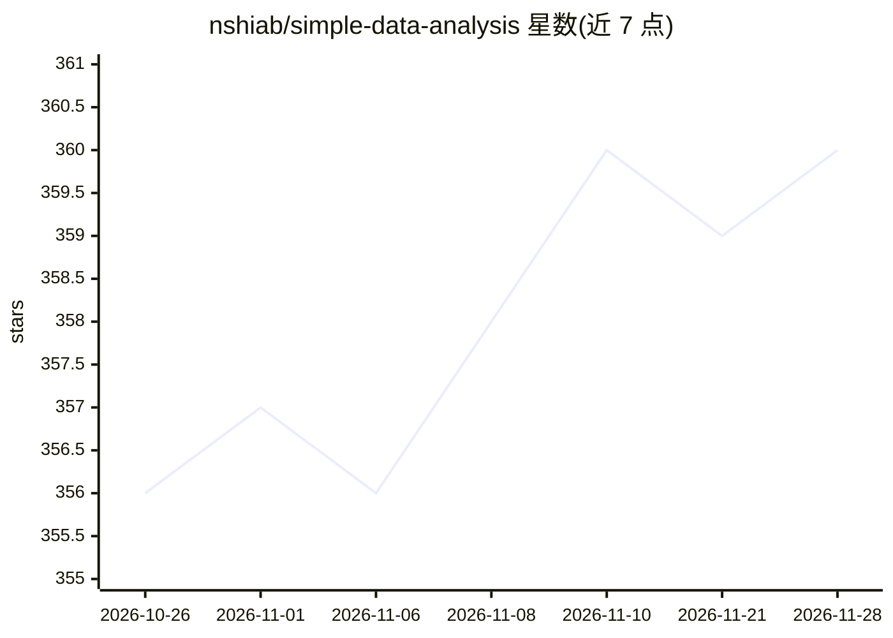

# nshiab/simple-data-analysis

⭐ 360 · TypeScript · MIT · 推送 2026-11-26 · [GitHub](https://github.com/nshiab/simple-data-analysis) · [官网](https://nshiab.github.io/simple-data-analysis/) · 个人维护

**给数据记者和 JS 开发者的 DuckDB 数据分析库，内置 AI 方法**

基于 DuckDB 的 TypeScript 库，运行于 Node.js，支持表格、地理空间、向量相似度分析及 AI 方法（逐行 LLM 处理、嵌入生成、RAG、自然语言查询），另含 Google Sheets/Cloud Storage 集成与图表/地图导出。核心变换按队列融合为单条 DuckDB 语句以减少往返。AI 能力通过 .env 配置接入 Gemini/Vertex AI 或本地 Ollama，LLM 响应与嵌入默认缓存。面向数据新闻与 JavaScript 生态的数据分析场景；提供 npm 安装与免费配套课程。

## 筛选速览

| 维度 | 判定 | 备注 |
|---|---|---|
| AI 角色 | `ai-enhanced` | 去掉 AI 部分产品仍成立 |
| 许可风险 | `permissive` | MIT |
| 部署形态 | `library` | 以包/库形式分发 |
| 模型依赖 | local-ok | 支持本地模型 |
| 硬件要求 | — | 无带数字的原话,不猜 |
| 安装摩擦 | `low` | 无编译、无系统依赖或容器化 |
| 成熟度 | — | 结构信号不足 |

## 能力要点

- 核心操作队列化并融合为单条 DuckDB 语句，减少数据库往返
- aiRowByRow 支持并发逐行 LLM 结构化富集，可记录行级错误与重试
- AI/Gemini/Ollama 依赖按需懒加载，仅用核心方法时无额外启动成本
- LLM 响应与嵌入缓存在本地隐藏目录，避免重复调用

## 适用场景

- 数据新闻项目中用 TypeScript 完成数据处理到可视化全流程
- 对表格列批量调用 LLM 做清洗、抽取、分类与富集
- 生成文本嵌入做语义搜索与聚类
- 直接加载加拿大统计局和 OpenStreetMap 公共数据

## 场景标签

`数据分析` `语义搜索` · 领域:效率与自动化

## 证据(README 行号)

> L7: SDA is a fast and easy-to-use TypeScript library for tabular, geospatial,
> L33: - **`simple-data-analysis`** (this package) extends the core with additional
> L282: SDA can use LLMs and embedding models to enrich data, search text, and answer

## 星数曲线

2026-10-26 356 → 2026-11-28 360（+4）

---
*卡片 v1 · prompt 1.4 · 生成 2026-11-27 · 置信度 high · 依据 README sha `37271af08e48` · [字段定义](../../DATASET.md)*
