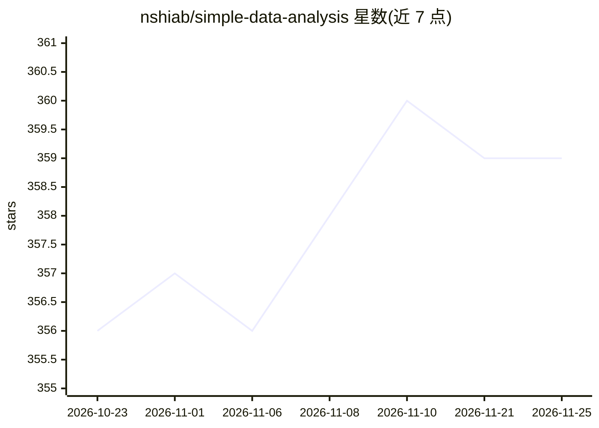

# nshiab/simple-data-analysis

⭐ 359 · TypeScript · MIT · 推送 2026-11-19 · [GitHub](https://github.com/nshiab/simple-data-analysis) · [官网](https://nshiab.github.io/simple-data-analysis/) · 个人维护

**面向数据工作者的 TypeScript 数据分析库（基于 DuckDB）**

基于 DuckDB 的 TypeScript 库，提供表格分析、地理空间分析、网络图分析、向量相似度检索、图表输出（终端图表与 Observable Plot 图像）等方法，运行于 Node.js。扩展包在核心之上加入 AI 方法（逐行处理、嵌入、混合检索、RAG、自然语言查询）、Google Sheets/Cloud Storage 集成，AI 能力来自 journalism-ai 库，响应与嵌入默认本地缓存。由 CBC News 计算记者维护，附免费数据分析课程。

## 筛选速览

| 维度 | 判定 | 备注 |
|---|---|---|
| AI 角色 | `ai-enhanced` | 去掉 AI 部分产品仍成立 |
| 许可风险 | `permissive` | MIT |
| 部署形态 | `library` | 以包/库形式分发 |
| 模型依赖 | local-ok | 支持本地模型 |
| 硬件要求 | — | 无带数字的原话,不猜 |
| 安装摩擦 | `low` | 无编译、无系统依赖或容器化 |
| 成熟度 | — | 结构信号不足 |

## 能力要点

- 核心操作队列化并融合为单条 DuckDB 语句以减少往返
- 支持 Gemini API、Vertex AI 与本地 Ollama 三种 AI 后端配置
- loadStatCanData/loadOpenStreetMap 直接读取公共数据源并本地缓存
- aiRowByRow 并发处理并记录行级错误，支持 retry/retryCheck

## 适用场景

- 在 JS/TS 中完成数据清洗、汇总与地理空间分析
- 用 LLM 对表格逐行做分类、抽取与数据富化
- 生成文本嵌入并做聚类与语义搜索
- 为新闻数据项目生成图表与地图

## 场景标签

`数据分析` `语义搜索` `教程课程` · 领域:效率与自动化

## 证据(README 行号)

> L7: SDA is a fast and easy-to-use TypeScript library for tabular, geospatial,
> L33: - **`simple-data-analysis`** (this package) extends the core with additional
> L258: SDA can use LLMs and embedding models to enrich data, search text, and answer

## 星数曲线

2026-10-23 356 → 2026-11-25 359（+3）

---
*卡片 v1 · prompt 1.4 · 生成 2026-11-25 · 置信度 high · 依据 README sha `d3da84985d02` · [字段定义](../../DATASET.md)*
