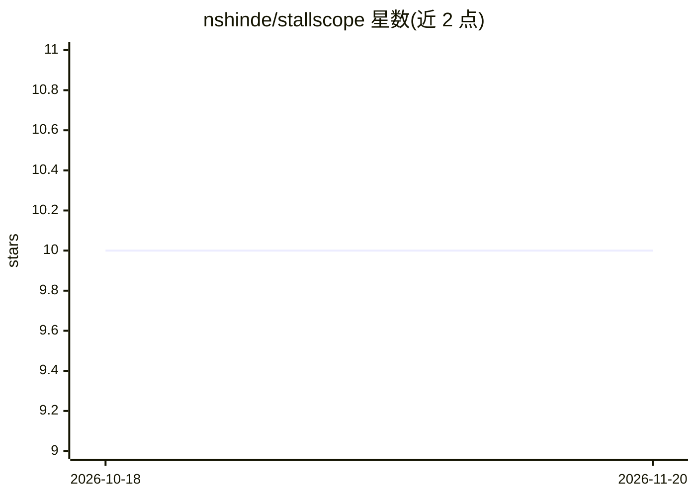

# nshinde/stallscope

⭐ 10 · Python · Apache-2.0 · 推送 2026-06-13 · [GitHub](https://github.com/nshinde/stallscope) · 个人维护

**GPU 训练节点的瓶颈画像与早期告警工具**

面向 GPU 训练节点的 Python 可观测性工具：采集本机 GPU、主机、网络、RDMA/RoCEv2、PFC pause 计数器及 Slurm/Kubernetes 调度上下文，用规则引擎对当前训练任务打标为 FAST/SLOW/FAIL_RISK/UNKNOWN 并给出瓶颈类型提示。支持周期采集、Prometheus textfile 输出供 node_exporter 读取，并可向 Alertmanager 发送 webhook 告警；可选运行 NCCL all-reduce 基准（需 all_reduce_perf 在 PATH）。运行时仅依赖 Python 3.10+ 标准库，解析器可用 fixture 在无 GPU/RDMA 硬件上测试。

## 筛选速览

| 维度 | 判定 | 备注 |
|---|---|---|
| AI 角色 | `ai-ecosystem` | LLM/agent 周边工具 |
| 许可风险 | `permissive` | Apache-2.0 |
| 部署形态 | `self-host` | docker 或自建部署 |
| 模型依赖 | — | README 未给出锁定关系 |
| 硬件要求 | — | 无带数字的原话,不猜 |
| 安装摩擦 | `low` | 无编译、无系统依赖或容器化 |
| 成熟度 | — | 结构信号不足 |

## 能力要点

- 采集 GPU、RDMA/RoCEv2、PFC pause 等多类计数器并与任务上下文关联
- 规则引擎输出 FAST/SLOW/FAIL_RISK/UNKNOWN 标签与瓶颈提示
- Prometheus textfile 输出与 Alertmanager webhook 告警
- 运行时仅标准库，无 GPU/RDMA 环境可用 fixture 测试解析

## 适用场景

- 排查 GPU 训练任务变慢是否由 RDMA 网络拥塞引起
- Slurm/K8s 集群节点上的训练健康监控与预警
- 通过 node_exporter 将瓶颈指标纳入现有 Prometheus 监控

## 场景标签

`MLOps` · 领域:训练与推理

## 证据(README 行号)

> L3: Correlate GPU training job health with RDMA fabric counters on the same node with shared job context.
> L5: `stallscope` is a Python 3.10+ observability utility for GPU training nodes. It collects local GPU, host, network, R
> L85: Alert generation categorizes fabric congestion and RDMA transport reasons as `category="fabric"`. Existing GPU, net

## 星数曲线

2026-10-18 10 → 2026-11-20 10（+0）

---
*卡片 v1 · prompt 1.4 · 生成 2026-11-19 · 置信度 high · 依据 README sha `d91f6295b355` · [字段定义](../../DATASET.md)*
