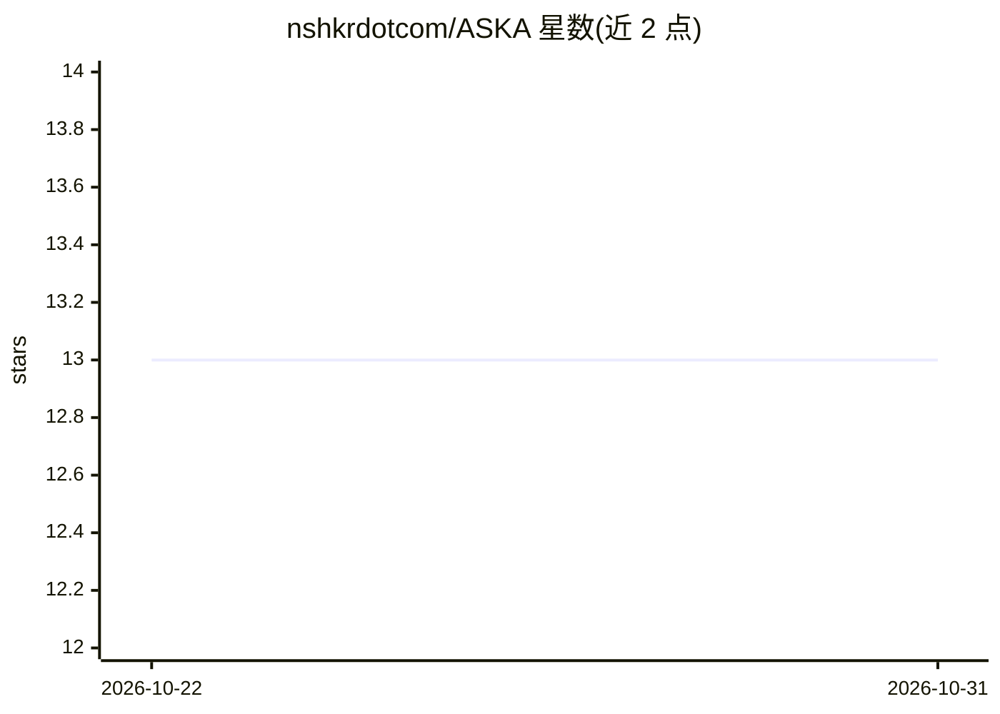

# nshkrdotcom/ASKA

⭐ 13 · Shell · CC-BY-4.0 · 推送 2026-10-24 · [GitHub](https://github.com/nshkrdotcom/ASKA) · 组织维护

**AI 时代的权限契约计算架构规范（ASKA v5），面向安全研究**

一份名为 ASKA v5 的形式化架构与协议规范文档集，将计算机与网络视为统一的可执行权限系统：以 Claim → Contract → Grant → Receipt 为基础，通过 PACT 协议协商权限，由四个社会平面（Sanctum/Polis/Agora/Wilder）加 Steles 见证平面与 Keystone 本地信任根组成 4+1 端点，规范 AI 参与交互但不赋予其管理员/签发者地位。README 明确声明这是统一目标与可测试研究计划，并非已完成实现。内容为 34 章编号技术文档，含需求、威胁模型、一致性测试与研究路线。

## 筛选速览

| 维度 | 判定 | 备注 |
|---|---|---|
| AI 角色 | `ai-knowledge` | 知识聚合/清单类 |
| 许可风险 | `viral` | CC-BY-4.0 |
| 部署形态 | `None` |  |
| 模型依赖 | — | README 未给出锁定关系 |
| 硬件要求 | — | 无带数字的原话,不猜 |
| 安装摩擦 | `low` | 无编译、无系统依赖或容器化 |
| 成熟度 | `idea` | |

## 能力要点

- Claim → Contract → Grant → Receipt 权限链与 PACT 协商协议
- 4+1 端点平面划分（Sanctum/Polis/Agora/Wilder + Steles）
- 34 章规范文档覆盖架构、威胁模型、一致性测试与研究计划
- 明确区分规范性义务与未解决的实现问题

## 适用场景

- 研究 AI 时代以权限契约为中心的安全计算架构
- 查阅端点隔离、信息流控制与法律流程的设计规范
- 作为可信计算/机密计算方向的架构参考文档

## 场景标签

`网络安全` · 领域:学习与行业

## 证据(README 行号)

> L3:  Formal architecture and protocol specification · 23 October 2026
> L5: > **Architecture status:** ASKA v5 specifies a unified target and a testable research program. It is not a claim of 

## 星数曲线

2026-10-22 13 → 2026-10-31 13（+0）

---
*卡片 v1 · prompt 1.4 · 生成 2026-10-31 · 置信度 mid · 依据 README sha `9abf3c47c22e` · [字段定义](../../DATASET.md)*
