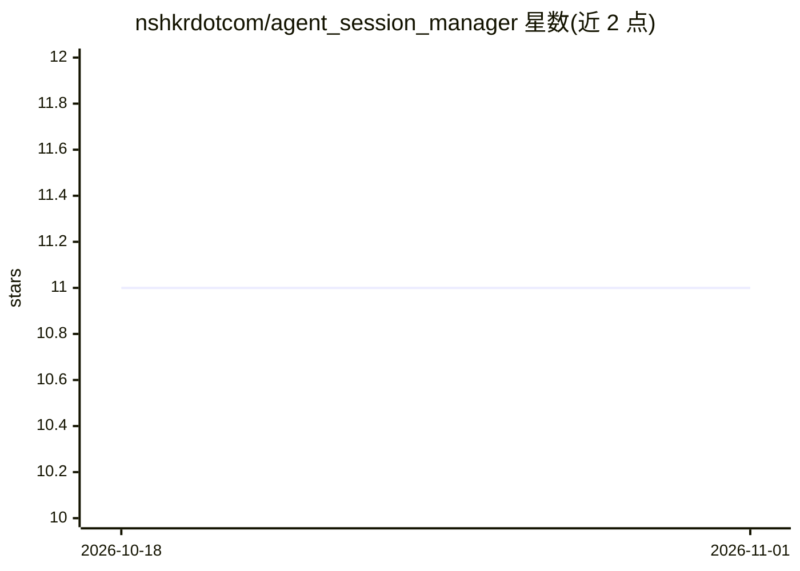

# nshkrdotcom/agent_session_manager

⭐ 11 · Elixir · MIT · 推送 2026-10-27 · [GitHub](https://github.com/nshkrdotcom/agent_session_manager) · 个人维护

**Elixir/OTP 多轮 AI agent 会话运行时，统一五种 CLI provider**

OTP 原生的 Elixir 库（ASM），用一套 API 运行跨五个第一方 CLI provider 的多轮 AI 会话：Claude CLI、Codex CLI、Amp CLI、Cursor Agent CLI、Antigravity CLI。核心机制：共享事件词汇表包装为 %ASM.Event{}、原生 Enumerable 流式输出与 reducer 结果投影、provider 注册表将 provider 解析到 core/SDK 后端 lane、可选 provider SDK 依赖按需激活、传输中立的 execution_surface 契约（含 SSH 执行与 guest bridge）。经 Hex 依赖安装，需 Elixir 1.19+，并要求各自安装与认证 provider CLI。

## 筛选速览

| 维度 | 判定 | 备注 |
|---|---|---|
| AI 角色 | `ai-ecosystem` | LLM/agent 周边工具 |
| 许可风险 | `permissive` | MIT |
| 部署形态 | `library` | 以包/库形式分发 |
| 模型依赖 | local-ok | 支持本地模型 |
| 硬件要求 | — | 无带数字的原话,不猜 |
| 安装摩擦 | `low` | 无编译、无系统依赖或容器化 |
| 成熟度 | — | 结构信号不足 |

## 能力要点

- 单一会话/运行时模型覆盖 5 个 CLI provider
- 原生 Elixir 流式（Enumerable）与 reducer 结果投影
- 可选 provider SDK 依赖声明即激活，无需额外接线
- 传输中立的 execution_surface 契约支持 SSH 与 guest bridge

## 适用场景

- 在 Elixir/OTP 应用中统一驱动多个编码 agent CLI
- 通过 ASM.InferenceEndpoint 将 CLI provider 发布为推理端点
- 以统一事件模型构建多 agent 会话编排

## 场景标签

`多智能体` `Agent 框架` · 领域:Agent 开发

## 证据(README 行号)

> L12: `ASM` is an OTP-native Elixir runtime for running multi-turn AI sessions across
> L18: - Codex CLI (`exec` mode plus SDK app-server host tools when requested)

## 星数曲线

2026-10-18 11 → 2026-11-01 11（+0）

---
*卡片 v1 · prompt 1.4 · 生成 2026-11-01 · 置信度 mid · 依据 README sha `a8da69b9cb46` · [字段定义](../../DATASET.md)*
