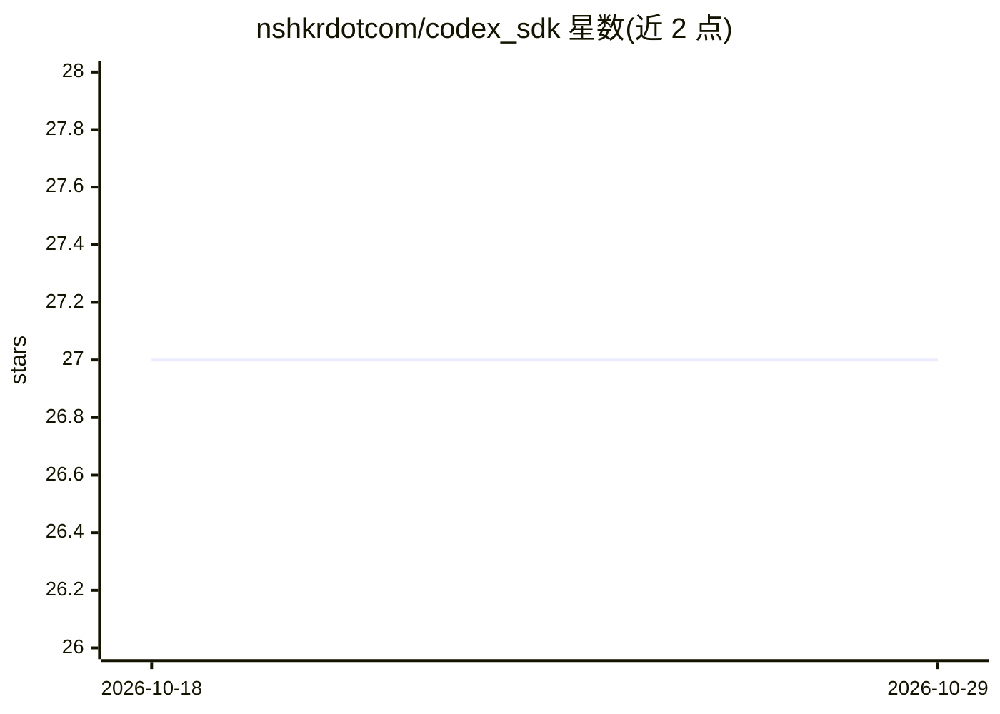

# nshkrdotcom/codex_sdk

⭐ 27 · Elixir · MIT · 推送 2026-10-27 · [GitHub](https://github.com/nshkrdotcom/codex_sdk) · 个人维护

**Elixir 编写的 OpenAI Codex agent SDK，封装 codex CLI**

面向 Elixir/Erlang VM 开发者的 OpenAI Codex SDK：通过包装 codex-rs 可执行文件，提供 Codex 线程全生命周期管理、exec JSONL 与 app-server JSON-RPC 双传输、CLI 直通与 PTY 会话、原生 OAuth、流式事件、审批钩子与沙箱策略、MCP 集成、本地插件编写及 Realtime API 语音管线。模型目录与默认选择委托给 cli_subprocess_core 共享核心；需系统预装 codex CLI（npm/Homebrew）并经 ChatGPT 账号或 API key 认证；支持经共享核心以 Ollama 作为本地 OSS 后端。以 Hex 依赖（mix.exs）安装，要求 Elixir 1.19。

## 筛选速览

| 维度 | 判定 | 备注 |
|---|---|---|
| AI 角色 | `ai-ecosystem` | LLM/agent 周边工具 |
| 许可风险 | `permissive` | MIT |
| 部署形态 | `library` | 以包/库形式分发 |
| 模型依赖 | local-ok | 支持本地模型 |
| 硬件要求 | — | 无带数字的原话,不猜 |
| 安装摩擦 | `low` | 无编译、无系统依赖或容器化 |
| 成熟度 | — | 结构信号不足 |

## 能力要点

- 封装 codex-rs 可执行文件，提供 exec 与 app-server 双传输
- 原生 OAuth（浏览器/device code 登录）与多级 API key 认证解析
- CLI 直通、审批钩子、沙箱策略与 MCP 工具集成
- 支持经共享核心路由以 Ollama 作为本地 OSS 模型后端

## 适用场景

- 在 Elixir/Phoenix 应用中嵌入 Codex 编码 agent 并处理流式事件
- 通过 OAuth 或 API key 接入 ChatGPT 账号使用 Codex CLI 能力
- 以本地 Ollama 模型替代云端模型运行 Codex 工作流
- 用 Elixir 编写并管理 Codex 本地插件与 marketplace

## 场景标签

`Agent 框架` `编码 Agent` · 领域:Agent 开发

## 证据(README 行号)

> L8: An idiomatic Elixir SDK for embedding OpenAI's Codex agent in your workflows and applications. This SDK wraps the `c
> L63: Add `codex_sdk` to your list of dependencies in `mix.exs`:
> L80: You must have the `codex` CLI installed. Install it via npm or Homebrew:

## 星数曲线

2026-10-18 27 → 2026-10-29 27（+0）

---
*卡片 v1 · prompt 1.4 · 生成 2026-10-26 · 置信度 mid · 依据 README sha `890acbb96304` · [字段定义](../../DATASET.md)*
