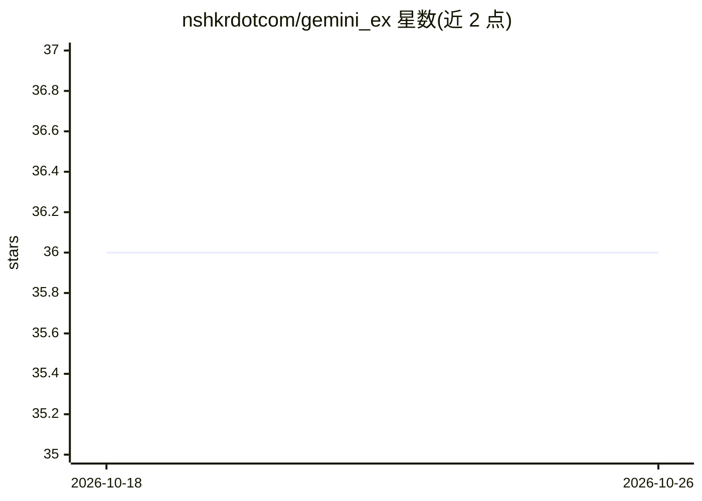

# nshkrdotcom/gemini_ex

⭐ 36 · Elixir · MIT · 推送 2026-09-17 · [GitHub](https://github.com/nshkrdotcom/gemini_ex) · 个人维护

**Elixir 的 Google Gemini API 客户端库，支持 AI Studio 与 Vertex AI**

面向 Elixir 开发者的 Gemini SDK：以 mix 依赖形式提供，覆盖文本生成、SSE 流式输出、WebSocket Live API 实时会话、自动多轮工具调用、结构化 JSON 输出、上下文缓存、Files/Batches/Tunings/Documents 等接口，并内置限流重试、并发门控与遥测。认证支持 Gemini API key 与 Vertex AI OAuth/服务账户/ADC 双通道，另集成 ALTAR 平台的 LATER/GRID 协议提供部署路径。需要 GEMINI_API_KEY 或 GCP 凭证。

## 筛选速览

| 维度 | 判定 | 备注 |
|---|---|---|
| AI 角色 | `ai-ecosystem` | LLM/agent 周边工具 |
| 许可风险 | `permissive` | MIT |
| 部署形态 | `None` |  |
| 模型依赖 | — | README 未给出锁定关系 |
| 硬件要求 | — | 无带数字的原话,不猜 |
| 安装摩擦 | `low` | 无编译、无系统依赖或容器化 |
| 成熟度 | — | 结构信号不足 |

## 能力要点

- 支持 AI Studio API key 与 Vertex AI 双认证（含 ADC）
- 自动多轮工具调用与 Live API WebSocket 双向实时会话
- 内置限流处理、重试、并发门控与遥测
- 上下文缓存、结构化 JSON 输出与多模态输入

## 适用场景

- 在 Elixir/Phoenix 应用中接入 Gemini 生成与流式对话
- 构建带工具调用的 agent 或实时语音交互会话
- 通过 Vertex AI 在 GCP 环境调用 Gemini 并做成本与并发管理

## 场景标签

 · 领域:LLM 基础设施/SDK

## 证据(README 行号)

> L12: A comprehensive Elixir client for Google's Gemini AI API with dual authentication support, advanced streaming capab
> L18: - **Dual Authentication**: Seamless support for both Gemini API keys and Vertex AI OAuth/Service Accounts

## 星数曲线

2026-10-18 36 → 2026-10-26 36（+0）

---
*卡片 v1 · prompt 1.4 · 生成 2026-10-25 · 置信度 high · 依据 README sha `8098b4d460fd` · [字段定义](../../DATASET.md)*
