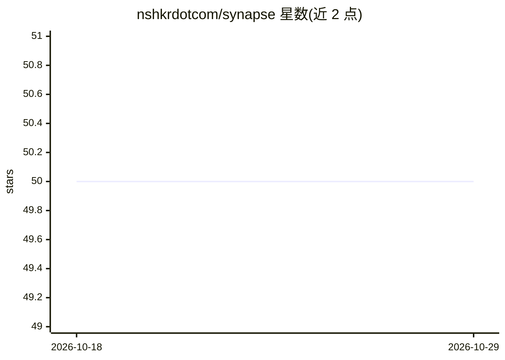

# nshkrdotcom/synapse

⭐ 50 · Elixir · MIT · 推送 2026-09-30 · [GitHub](https://github.com/nshkrdotcom/synapse) · [官网](https://github.com/nshkrdotcom/synapse) · 组织维护

**Elixir 声明式多 agent 编排框架，含信号总线与工作流引擎**

运行于 Erlang VM 的 headless 多 agent 编排框架：提供领域无关的信号注册与路由、声明式工作流引擎（步骤/依赖/重试/补偿）及可配置编排 agent 运行时，持久化到 Postgres 的 workflow_executions 表并输出审计轨迹；内置代码评审领域作为参考实现，可注册自定义领域。LLM 网关可选接入 Altar.AI，原 Synapse.ReqLLM 已标记废弃；支持 OpenAI/Gemini 环境变量配置、Jido.Plan 编译、LineageIR 追踪与 telemetry。面向用 Elixir/OTP 构建多 agent 系统的开发者，属 OTP-only 应用，无 Phoenix 端点，版本 v0.1.1。

## 筛选速览

| 维度 | 判定 | 备注 |
|---|---|---|
| AI 角色 | `ai-ecosystem` | LLM/agent 周边工具 |
| 许可风险 | `permissive` | MIT |
| 部署形态 | `None` |  |
| 模型依赖 | — | README 未给出锁定关系 |
| 硬件要求 | — | 无带数字的原话,不猜 |
| 安装摩擦 | `low` | 无编译、无系统依赖或容器化 |
| 成熟度 | — | 结构信号不足 |

## 能力要点

- 领域无关信号注册表与运行时主题注册
- 声明式工作流引擎：重试、补偿、Postgres 持久化与审计轨迹
- 内置代码评审领域（协调者 + 安全/性能专家 agent）作参考实现
- Jido.Plan DAG 编译为工作流 spec；全链路 telemetry

## 适用场景

- 在 CI 或脚本中发布 review_request 信号执行 AI 代码评审
- 构建自定义领域的多 agent 编排系统
- 查询 Postgres 审计数据驱动看板或重跑失败步骤

## 场景标签

`Agent 框架` `多智能体` · 领域:Agent 开发

## 证据(README 行号)

> L13: Synapse is a headless, declarative multi‑agent orchestration framework. It provides a domain‑agnostic signal bus, w
> L23: - LLM gateway powered by Altar.AI (optional) with ReqLLM fallback

## 星数曲线

2026-10-18 50 → 2026-10-29 50（+0）

---
*卡片 v1 · prompt 1.4 · 生成 2026-10-24 · 置信度 high · 依据 README sha `bc1d92ef5a1b` · [字段定义](../../DATASET.md)*
