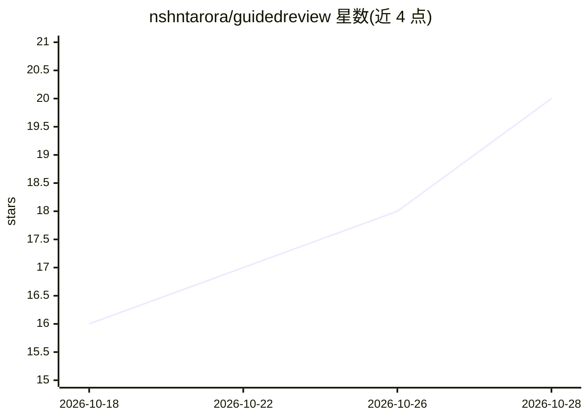

# nshntarora/guidedreview

⭐ 20 · TypeScript · Apache-2.0 · 推送 2026-10-27 · [GitHub](https://github.com/nshntarora/guidedreview) · [官网](https://guidedreview.dev) · 个人维护

**把 git diff / GitHub PR 变成有序 AI 代码走查的开发者工具**

由 CLI 与 Chrome 扩展组成的代码审查工具：读取 GitHub PR 或本地 git 变更（分支对比、未提交、单 commit），由用户自带 API key 的 LLM 将相关 hunk 聚类为有序的 review units 并附简短摘要，键盘逐单元走查；代码始终来自真实 diff，最终判断由审查者做出。无产品后端，扩展与 CLI 直连 AI 提供商（Anthropic/OpenAI/Grok 或本机 coding agent）。无 key 时退化为按文件逐单元导航。

## 筛选速览

| 维度 | 判定 | 备注 |
|---|---|---|
| AI 角色 | `ai-enhanced` | 去掉 AI 部分产品仍成立 |
| 许可风险 | `permissive` | Apache-2.0 |
| 部署形态 | `library` | 以包/库形式分发 |
| 模型依赖 | locked-api |  |
| 硬件要求 | — | 无带数字的原话,不猜 |
| 安装摩擦 | `low` | 无编译、无系统依赖或容器化 |
| 成熟度 | — | 结构信号不足 |

## 能力要点

- LLM 聚类相关 hunk 为有序 review units 并生成摘要
- CLI 覆盖本地 git 变更（分支/未提交/staged/单 commit）
- 自带 API key、无产品后端，扩展密钥存于 chrome.storage.local
- Generate Prompt 可将行内笔记组装为 coding-agent 提示词

## 适用场景

- 审查 AI 生成的大型 PR，按逻辑顺序而非字母序阅读 diff
- 提交 PR 前在本地走查自己的改动
- 把走查笔记生成提示词交给 coding agent 处理

## 场景标签

`代码审查` · 领域:编码与开发

## 证据(README 行号)

> L9: Guided Review turns GitHub pull requests and local git changes into an ordered walkthrough of **review units** so yo
> L30: Guided Review uses AI only where it helps: clustering related hunks into a walkable order and adding short summarie

## 星数曲线

2026-10-18 16 → 2026-10-28 20（+4）

---
*卡片 v1 · prompt 1.4 · 生成 2026-10-28 · 置信度 high · 依据 README sha `9138a671d1b9` · [字段定义](../../DATASET.md)*
