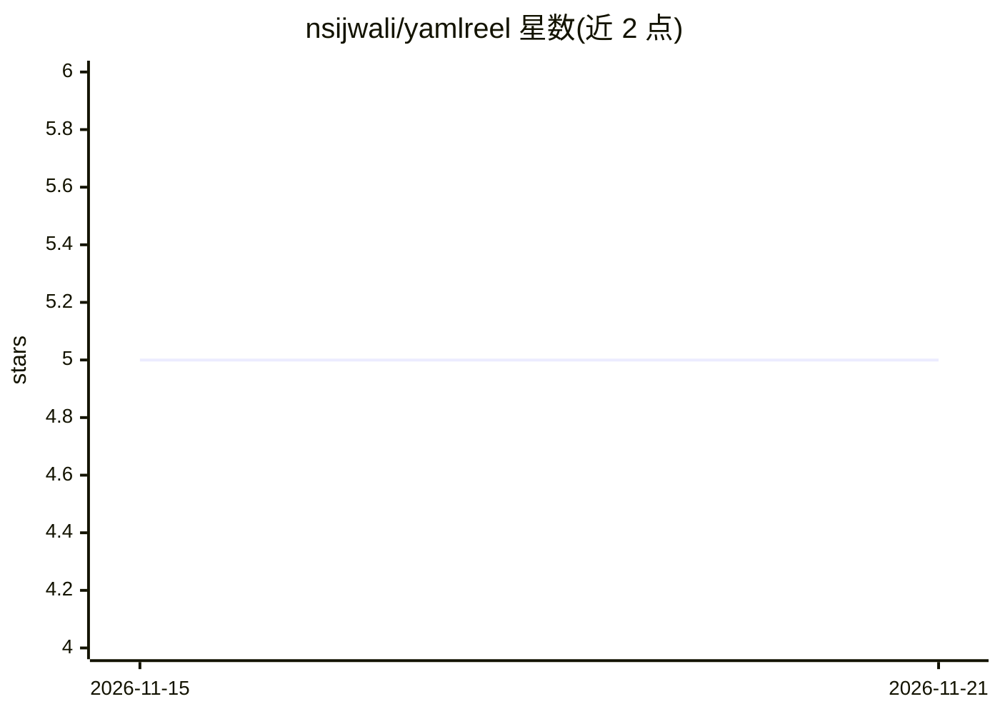

# nsijwali/yamlreel

⭐ 5 · Python · MIT · 推送 2026-11-20 · [GitHub](https://github.com/nsijwali/yamlreel) · [官网](https://nsijwali.github.io/yamlreel/) · 个人维护

**写 YAML 文件即可本地渲染解说视频的命令行工具**

yamlreel 将一份 YAML 场景说明渲染为成品视频：动画图表、逐字打字的代码、表格与数组动画、机器本地生成的配乐（五种风格）、卡拉OK式逐词字幕与可选的自有声音旁白。输出横屏/竖屏/方形三种剪辑、H.264 视频与首帧海报、联络图，并生成可直接粘贴的标题、描述与话题标签。提供 init/story/script/render/check-voice 等子命令，story 子命令离线生成叙事大纲，事件校验器在非法状态时给出定位到具体步骤的错误。

## 筛选速览

| 维度 | 判定 | 备注 |
|---|---|---|
| AI 角色 | `ai-enhanced` | 去掉 AI 部分产品仍成立 |
| 许可风险 | `permissive` | MIT |
| 部署形态 | `library` | 以包/库形式分发 |
| 模型依赖 | — | README 未给出锁定关系 |
| 硬件要求 | — | 无带数字的原话,不猜 |
| 安装摩擦 | `medium` | 含编译或系统依赖之一 |
| 成熟度 | — | 结构信号不足 |

## 能力要点

- 一次渲染输出横屏 1920×1080、竖屏 1080×1920、方形 1080×1080 与海报、联络图、分享文案
- 本地生成配乐与逐词字幕，无需网络与额外依赖
- narration_words 支持外部对齐器产出的 JSON 精确时间轴
- yamlreel story 离线生成带 hook/问题/结尾卡的大纲，事件非法时报定位错误

## 适用场景

- 为 YouTube、Shorts、LinkedIn 制作系统设计解说与代码技巧短视频
- 发布项目时用一份 YAML 生成功能演示视频
- 为已有旁白录音生成逐词字幕并导出 SRT

## 场景标签

`视频生成` `语音合成` · 领域:内容生成

## 证据(README 行号)

> L48: pip install "yamlreel[ffmpeg]"
> L83: - **ffmpeg:** yamlreel uses the `ffmpeg` on your PATH if there is one, and otherwise the copy that the `[ffmpeg]` e
> L86: - **Voice check** is only needed for `yamlreel check-voice` (Checking the voice). The `[verify]` extra installs `fa

## 星数曲线

2026-11-15 5 → 2026-11-21 5（+0）

---
*卡片 v1 · prompt 1.4 · 生成 2026-11-21 · 置信度 mid · 依据 README sha `9a61555b900f` · [字段定义](../../DATASET.md)*
