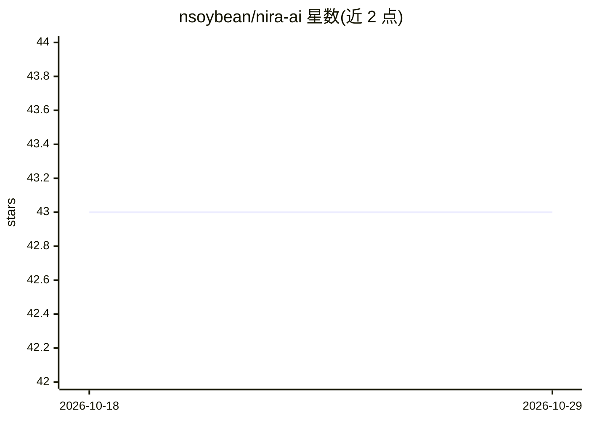

# nsoybean/nira-ai

⭐ 43 · TypeScript · 推送 2026-05-04 · [GitHub](https://github.com/nsoybean/nira-ai) · [官网](https://nira-ai.vercel.app) · 个人维护

**个人 Agent 式对话助手，多模型组合完成研究与创作任务**

基于 Next.js 16 与 Vercel AI SDK 构建的对话式 AI 工作区，支持 Claude、GPT、Gemini 多模型切换。Agent 可调用组合工具：Tavily/Anthropic/OpenAI 网络搜索与抽取、演示文稿大纲生成、Markdown 文档、任务管理，产出幻灯片与文档等 artifact 并持久化到 PostgreSQL。另含 Telegram 连接器（MVP）与每日定时自动化调度（MVP）。需自行部署：Node.js 20+、PostgreSQL、各 AI 提供商 API key；提供 Electron 桌面封装（DMG，CI 构建未签名）。

## 筛选速览

| 维度 | 判定 | 备注 |
|---|---|---|
| AI 角色 | `ai-native` | 本体是模型或模型工具 |
| 许可风险 | `none` | — |
| 部署形态 | `library` | 以包/库形式分发 |
| 模型依赖 | locked-api |  |
| 硬件要求 | — | 无带数字的原话,不猜 |
| 安装摩擦 | `low` | 无编译、无系统依赖或容器化 |
| 成熟度 | `idea` | |

## 能力要点

- 多模型支持（Claude/GPT/Gemini）并可切换
- Agent 组合工具：搜索抽取、大纲、文档、任务管理
- 流式 artifact 生成、编辑与数据库持久化
- Telegram 连接器与每日自动化调度（均标注 MVP）

## 适用场景

- 自部署一个能联网调研并生成文档/幻灯片的 AI 助手
- 在 Telegram 群组中接入该助手并接收定时自动化输出
- 统一界面切换使用多家模型进行日常对话与创作

## 场景标签

`AI 助手` `聊天机器人` · 领域:对话与助手

## 证据(README 行号)

> L9: Nira AI is a conversational AI workspace that combines multiple leading language models with powerful, composable to
> L15: - **Multi-Model Support** — Claude, GPT, and Gemini models with seamless switching
> L21: - **Web Search & Extract** — Research topics using Tavily, Anthropic, or OpenAI search

## 星数曲线

2026-10-18 43 → 2026-10-29 43（+0）

---
*卡片 v1 · prompt 1.4 · 生成 2026-10-25 · 置信度 high · 依据 README sha `73f0f2fe85f1` · [字段定义](../../DATASET.md)*
