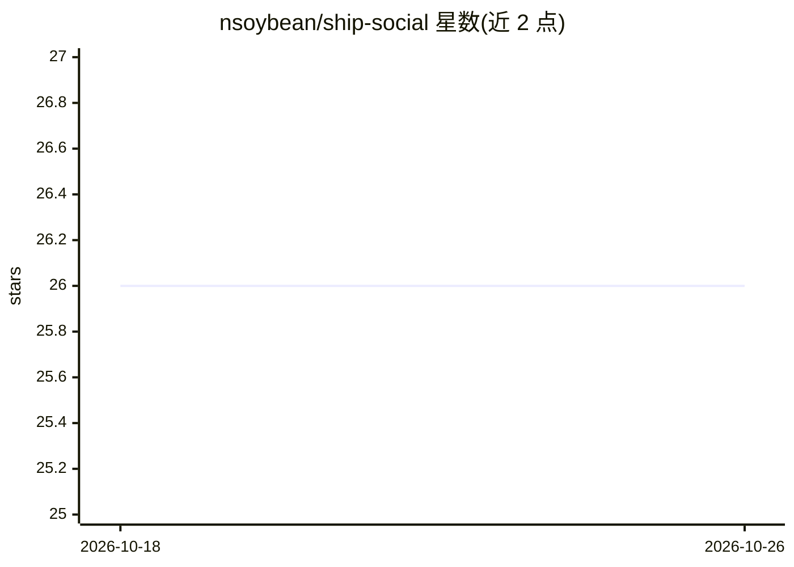

# nsoybean/ship-social

⭐ 26 · TypeScript · 推送 2026-03-10 · [GitHub](https://github.com/nsoybean/ship-social) · [官网](https://www.npmjs.com/package/ship-social) · 个人维护

**把 GitHub 发布与合并 PR 转成社交帖子草稿的本地 npm 工具**

面向开发者的本地 Web 应用：通过 GitHub token 读取指定仓库的最新 release 或合并 PR（含元数据、变更文件与提交信息），调用 AI 生成多条社交帖子草稿及配图，在收件箱中预览、编辑、批准后手动复制发布。支持语气档（预设/自定义/从过往帖子提取），文本与图像模型可经 Vercel AI Gateway 或 OpenAI key 路由，未配置 key 时不生成 AI 内容。Quickstart 命令内嵌 Postgres 并自动迁移，也可外接 Postgres 手动部署。

## 筛选速览

| 维度 | 判定 | 备注 |
|---|---|---|
| AI 角色 | `ai-native` | 本体是模型或模型工具 |
| 许可风险 | `none` | — |
| 部署形态 | `library` | 以包/库形式分发 |
| 模型依赖 | — | README 未给出锁定关系 |
| 硬件要求 | — | 无带数字的原话,不猜 |
| 安装摩擦 | `low` | 无编译、无系统依赖或容器化 |
| 成熟度 | — | 结构信号不足 |

## 能力要点

- 按 release→合并 PR 顺序解析发布信号，含 PR 变更文件与提交信息上下文
- 生成多条草稿变体与配图，草稿工作区带 X 风格预览
- 语气档：预设、自定义及从 3–5 条过往帖子 AI 提取
- AI 模型路由：AI Gateway 或 OpenAI key，两者皆无则不生成

## 适用场景

- 发布新版本后快速产出可直接发布的社交内容草稿
- 保持社交帖子与自己的写作语气一致
- 在不离开本地工作流的情况下审阅并批准发帖草稿

## 场景标签

`AI 写作` `图像生成` · 领域:内容生成

## 证据(README 行号)

> L15: Ship Social is a local npm tool that pulls shipping signals from your GitHub repos (releases or merged PRs) on dema
> L19: - **Get multiple draft variants** + a generated visual, ready to review in your inbox

## 星数曲线

2026-10-18 26 → 2026-10-26 26（+0）

---
*卡片 v1 · prompt 1.4 · 生成 2026-10-26 · 置信度 high · 依据 README sha `82752969c6c0` · [字段定义](../../DATASET.md)*
