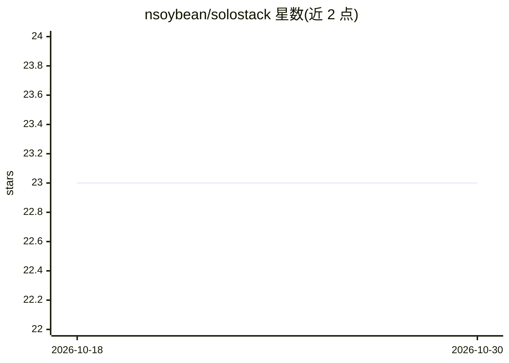

# nsoybean/solostack

⭐ 23 · TypeScript · 推送 2026-05-06 · [GitHub](https://github.com/nsoybean/solostack) · 个人维护

**本地优先的 AI 开发团队管理控制台：任务分派与审批多 agent 执行**

面向使用 Claude Code、Codex 等 agent CLI 的开发者，提供本地运行的编排控制台：从 React 仪表盘创建任务，由 orchestrator 分派给带角色与部门的 agent，manager agent 可拆分并委派子任务，运行活动经 SSE 实时回流，用户以审批/修订/重试方式介入而非手工提示。agent driver 可插拔（支持 Claude Code 与 Codex CLI），会话上下文跨运行持久化于本地 SQLite，另提供 Electron 桌面端（含 git diff 检查）与 CLI。需 Node.js 20+ 及至少一个受支持的 agent CLI。

## 筛选速览

| 维度 | 判定 | 备注 |
|---|---|---|
| AI 角色 | `ai-ecosystem` | LLM/agent 周边工具 |
| 许可风险 | `none` | — |
| 部署形态 | `library` | 以包/库形式分发 |
| 模型依赖 | — | README 未给出锁定关系 |
| 硬件要求 | — | 无带数字的原话,不猜 |
| 安装摩擦 | `low` | 无编译、无系统依赖或容器化 |
| 成熟度 | — | 结构信号不足 |

## 能力要点

- 多 agent 编排：角色、部门、委派范围与任务树拆分
- 可插拔 agent driver：支持 Claude Code 与 Codex CLI
- 审批式人机协作：运行活动实时回流，approve/revise/retry
- 本地 SQLite 持久化 + Electron 桌面端（每 agent 工作目录 git diff 检查）

## 适用场景

- 我有多位 AI agent，想要任务分派和执行留痕的统一管理
- 我想以审批方式介入 agent 执行而非反复手工提示
- 我想在本地跟踪 agent 会话上下文与运行历史

## 场景标签

`多智能体` `编码 Agent` · 领域:Agent 开发

## 证据(README 行号)

> L3: A local-first control plane for running your AI dev team. Create tasks, assign them to AI agents, and stay in the lo
> L20: - **Agent drivers** — pluggable support for Claude Code and Codex CLI

## 星数曲线

2026-10-18 23 → 2026-10-30 23（+0）

---
*卡片 v1 · prompt 1.4 · 生成 2026-10-27 · 置信度 high · 依据 README sha `a271b64a2d91` · [字段定义](../../DATASET.md)*
