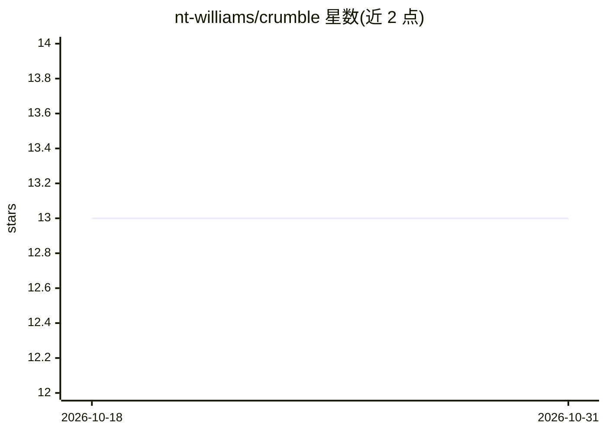

# nt-williams/crumble

⭐ 13 · R · GPL-3.0 · 推送 2026-05-04 · [GitHub](https://github.com/nt-williams/crumble) · 个人维护

**R 包：用机器学习估计因果中介效应**

crumble 是实现 Liu et al. 2024 统一估计策略的 R 包，用于因果中介分析，支持自然效应、有机效应、干预效应、recanting twins 等估计量，并结合修正处理政策。其采用 Riesz-learning 以深度学习估计所需 nuisance 参数，可处理二值/分类/连续/多变量暴露及高维中介变量。功能表标注 survey weights 与 clustered data 为 Planned，生命周期徽章为 experimental。通过 GitHub 安装，支持 GPU 与并行处理。面向开展因果推断统计分析的科研用户。

## 筛选速览

| 维度 | 判定 | 备注 |
|---|---|---|
| AI 角色 | `ai-native` | 本体是模型或模型工具 |
| 许可风险 | `viral` | GPL-3.0 |
| 部署形态 | `None` |  |
| 模型依赖 | — | README 未给出锁定关系 |
| 硬件要求 | — | 无带数字的原话,不猜 |
| 安装摩擦 | `low` | 无编译、无系统依赖或容器化 |
| 成熟度 | `idea` | |

## 能力要点

- 统一估计自然/有机/干预效应与 recanting twins 四类中介估计量
- Riesz-learning 用深度学习估计 nuisance 参数
- 支持二值/分类/连续/多变量暴露与高维中介变量
- 支持 GPU、并行处理与 super learner

## 适用场景

- 流行病学研究中估计处理通过中介变量产生的直接与间接效应
- 高维中介变量场景下的因果中介分析
- 处理政策（含修正处理政策）下的效应估计

## 场景标签

`科研工具` · 领域:学习与行业

## 证据(README 行号)

> L12: *crumble* implements a modern, unified estimation strategy (Liu et al.
> L16: combination with modified treatment policies. It makes use of recent
> L18: parameters using deep learning. The result is a software package that is

## 星数曲线

2026-10-18 13 → 2026-10-31 13（+0）

---
*卡片 v1 · prompt 1.4 · 生成 2026-10-31 · 置信度 high · 依据 README sha `4b45d59c88cd` · [字段定义](../../DATASET.md)*
