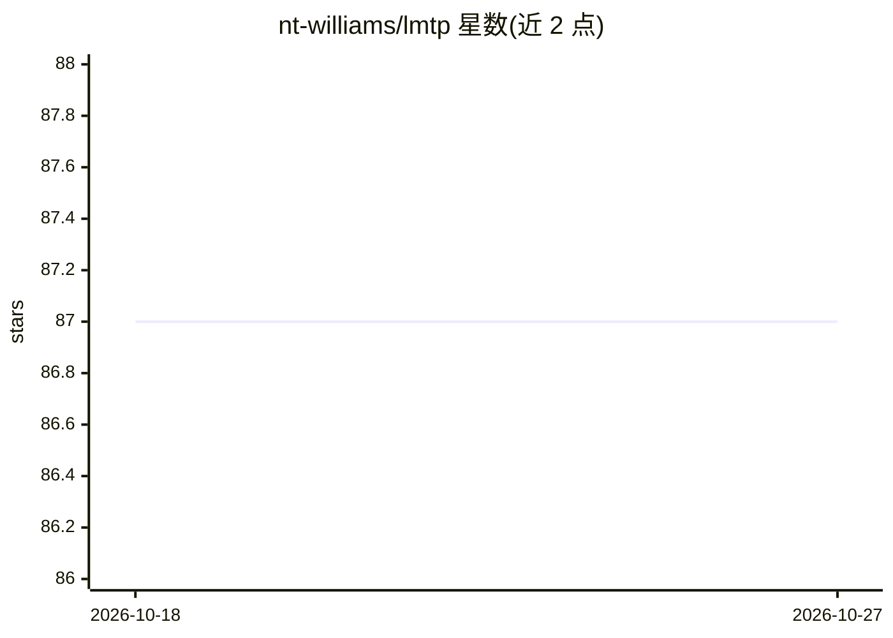

# nt-williams/lmtp

⭐ 87 · R · AGPL-3.0 · 推送 2026-07-01 · [GitHub](https://github.com/nt-williams/lmtp) · [官网](http://www.beyondtheate.com) · 个人维护

**R 包：估计修正治疗策略下的非参数因果效应**

面向因果推断研究者与统计分析师的 R 包，基于修正治疗策略（MTP）框架，估计可行干预的因果效应。提供 TMLE 与序列双重稳健（SDR）两种估计器，支持二值、连续、时间至事件（含竞争风险）及删失结局，处理点治疗与纵向数据。基于 SuperLearner 做集成机器学习估计，通过密度比分类估计治疗机制。亦可估计 ATE、动态治疗方案及增量倾向得分干预。限 R 环境，治疗缺失与中介分析尚未支持。

## 筛选速览

| 维度 | 判定 | 备注 |
|---|---|---|
| AI 角色 | `ai-native` | 本体是模型或模型工具 |
| 许可风险 | `viral` | AGPL-3.0 |
| 部署形态 | `None` |  |
| 模型依赖 | — | README 未给出锁定关系 |
| 硬件要求 | — | 无带数字的原话,不猜 |
| 安装摩擦 | `low` | 无编译、无系统依赖或容器化 |
| 成熟度 | — | 结构信号不足 |

## 能力要点

- TML 与序列双重稳健（SDR）两种估计器
- 支持二值/连续/删失/竞争风险结局的点治疗与纵向数据
- 基于 SuperLearner 的集成机器学习估计
- 支持静态/动态干预、增量倾向得分干预、调查权重与并行计算

## 适用场景

- 观察性数据中估计连续或多值暴露的因果效应
- 纵向删失生存数据下估计修正治疗策略效应
- 处理违背正定性假设的连续治疗场景

## 场景标签

 · 领域:统计/因果推断

## 证据(README 行号)

> L19: **lmtp** is an R package that provides an estimation framework for the
> L22: Hoffman, and Schenck (2020). Two primary estimators are supported, a
> L28: package to utilize ensemble machine learning for estimation. The

## 星数曲线

2026-10-18 87 → 2026-10-27 87（+0）

---
*卡片 v1 · prompt 1.4 · 生成 2026-10-23 · 置信度 mid · 依据 README sha `31ceaf9065ee` · [字段定义](../../DATASET.md)*
