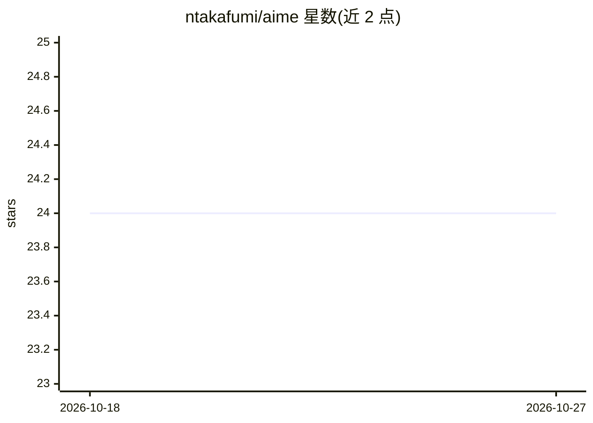

# ntakafumi/aime

⭐ 24 · Python · NOASSERTION · 推送 2026-07-20 · [GitHub](https://github.com/ntakafumi/aime) · 个人维护

**模型不可知的 XAI 库：学习逆算子解释黑箱模型**

Python 库，通过学习近似逆算子 A† 将模型输出映射回输入特征，从单个逆算子产出每类全局特征重要性、逐实例局部重要性、各类代表性输入模式与逆算子可视化，并以 BayesianAIME 提供 95% 可信区间的不确定性解释。模型不可知，仅消费模型的 predict_proba。同一 AIME 类提供五种变体（AIME/Huber/Ridge/Huber-Ridge/Bayesian）。附带 Colab notebook，图形默认出版级样式。限制：use_bayesian 不能与 Huber/Ridge 组合；RidgeAIME 在二分类且归一化时效果与 AIME 基本相同。

## 筛选速览

| 维度 | 判定 | 备注 |
|---|---|---|
| AI 角色 | `ai-native` | 本体是模型或模型工具 |
| 许可风险 | `none` | NOASSERTION |
| 部署形态 | `library` | 以包/库形式分发 |
| 模型依赖 | — | README 未给出锁定关系 |
| 硬件要求 | — | 无带数字的原话,不猜 |
| 安装摩擦 | `low` | 无编译、无系统依赖或容器化 |
| 成熟度 | — | 结构信号不足 |

## 能力要点

- 单类五变体：AIME、HuberAIME、RidgeAIME、Huber-RidgeAIME、BayesianAIME
- 模型不可知：只调用 predict_proba，不访问模型内部
- 每输出类独立的全局重要性、局部 Hadamard 分解与解析式显著性
- BayesianAIME 输出带 95% 可信区间的解释

## 适用场景

- 训练黑箱模型后获取全局与局部特征重要性解释
- 为论文生成出版级的解释可视化图表
- 在 Colab 中快速对比 AIME 与 SHAP/LIME 的解释对象

## 场景标签

 · 领域:机器学习可解释性

## 证据(README 行号)

> L11: AIME explains a trained black-box model by learning an approximate inverse operator `A†` that maps model outputs ba
> L87: AIME is model-agnostic — it consumes the model's `predict_proba`, never its

## 星数曲线

2026-10-18 24 → 2026-10-27 24（+0）

---
*卡片 v1 · prompt 1.4 · 生成 2026-10-27 · 置信度 high · 依据 README sha `2247bc4e56f4` · [字段定义](../../DATASET.md)*
