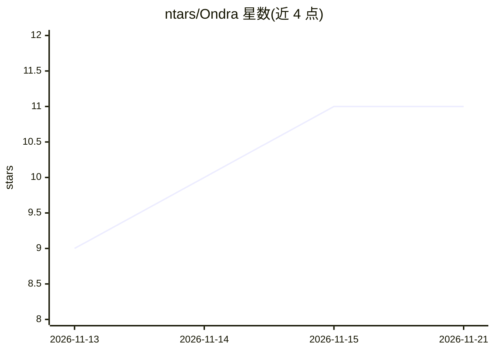

# ntars/Ondra

⭐ 11 · Dart · Apache-2.0 · 推送 2026-11-20 · [GitHub](https://github.com/ntars/Ondra) · [官网](https://ai.ntars.cn/) · 个人维护 · 中文 README

**本地数据、插件化架构的桌面 AI 陪伴体**

基于 Flutter 的三栏桌面应用，左右分别为导航与聊天窗口，能力由 Cordis 插件系统决定。通过 npm 安装的 dsh 内核子进程生成回复，默认经本机网关 magpie 路由，OpenAI 兼容接口，也可改配 LiteLLM、One API、Ollama。提供情绪、记忆、上下文机制，75 个可装卸插件，记忆支持 Markdown 导入导出与内容寻址备份快照。数据存于 ~/.ondra 本机目录，无后端。当前为 2.0.0-alpha，macOS 可运行，Windows/Linux 已生成工程但未完成原生入口。

## 筛选速览

| 维度 | 判定 | 备注 |
|---|---|---|
| AI 角色 | `ai-native` | 本体是模型或模型工具 |
| 许可风险 | `none` | Apache-2.0 |
| 部署形态 | `desktop` | 安装包/桌面程序 |
| 模型依赖 | locked-api |  |
| 硬件要求 | — | 无带数字的原话,不猜 |
| 安装摩擦 | `low` | 无编译、无系统依赖或容器化 |
| 成熟度 | `idea` | |

## 能力要点

- Cordis 插件体系：18 项随包清单 + 75 项内核装配，运行时可开关
- 记忆 Markdown 明文导入导出，带 id 对齐与去重
- 内容寻址备份快照与时间线回滚界面
- 本机网关 magpie（OpenAI 兼容），支持换接 LiteLLM/One API/Ollama

## 适用场景

- 在本机跑一个数据不出本地的桌面 AI 陪伴体
- 按需装卸插件扩展陪伴体的情绪、记忆、会话功能
- 把记忆导出为 Markdown 备份或迁移到另一台机器

## 场景标签

`AI 助手` · 领域:对话与助手

## 证据(README 行号)

> L3: 桌面陪伴体。本仓库是 **2.0.0-alpha**：Flutter 写的三栏桌面界面，左栏导航、中栏页面、
> L31: 桌面上右栏要真的生成回复，需要两件事：
> L260: 右栏默认不联外网，走本机网关 **magpie**（`/Applications/magpie.app`，监听

## 星数曲线

2026-11-13 9 → 2026-11-21 11（+2）

---
*卡片 v1 · prompt 1.4 · 生成 2026-11-18 · 置信度 high · 依据 README sha `10fb0bcad60f` · [字段定义](../../DATASET.md)*
