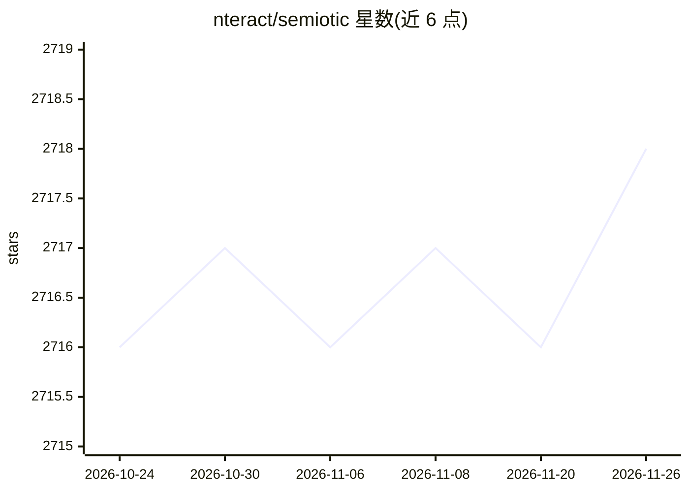

# nteract/semiotic

⭐ 2,718 · TypeScript · Apache-2.0 · 推送 2026-11-24 · [GitHub](https://github.com/nteract/semiotic) · [官网](https://semiotic.nteract.io) · 组织维护

**面向 AI 辅助开发的 React 数据可视化组件库**

提供 XY/分类/网络/地理/实时/物理等类别的 React 图表组件，采用 accessor 驱动的统一 prop API，并按图表族提供子路径入口（semiotic/xy、semiotic/geo 等）。针对 AI 辅助开发提供机器可读 schema、组件能力目录、MCP 服务器、CLI 校验工具、反模式诊断与数据预检函数，以及 llms.txt 与 AGENTS.md 等编码代理配套文件。要求 React 18.1+ 或 19；地理组件需可选的 world-atlas peer 依赖。

## 筛选速览

| 维度 | 判定 | 备注 |
|---|---|---|
| AI 角色 | `ai-enhanced` | 去掉 AI 部分产品仍成立 |
| 许可风险 | `permissive` | Apache-2.0 |
| 部署形态 | `library` | 以包/库形式分发 |
| 模型依赖 | — | README 未给出锁定关系 |
| 硬件要求 | — | 无带数字的原话,不猜 |
| 安装摩擦 | `low` | 无编译、无系统依赖或容器化 |
| 成熟度 | — | 结构信号不足 |

## 能力要点

- 11 类 90+ 图表组件，含实时 60fps canvas 渲染与 LinkedCharts 联动视图
- semiotic/ai 提供面向 LLM 代码生成的 schema 图表能力目录
- npx 提供 semiotic-mcp MCP 服务器与 semiotic-ai --doctor CLI 校验
- diagnoseConfig/auditData 做反模式检测与数值预检，Vega-Lite spec 可翻译

## 适用场景

- 在 React 应用中绘制网络图、桑基图与 choropleth 地图
- 为监控面板接入流式实时数据图表
- 让编码代理通过 schema 与 MCP 工具生成并校验图表代码

## 场景标签

 · 领域:数据可视化/前端组件库

## 证据(README 行号)

> L12: A React data visualization library designed for AI-assisted development and streaming data.
> L203: - **`semiotic/ai`** — a single import with the schema-backed chart capability catalog (XY, ordinal, network, realt

## 星数曲线

2026-10-24 2,716 → 2026-11-26 2,718（+2）

---
*卡片 v1 · prompt 1.4 · 生成 2026-11-26 · 置信度 high · 依据 README sha `fe14345454b0` · [字段定义](../../DATASET.md)*
