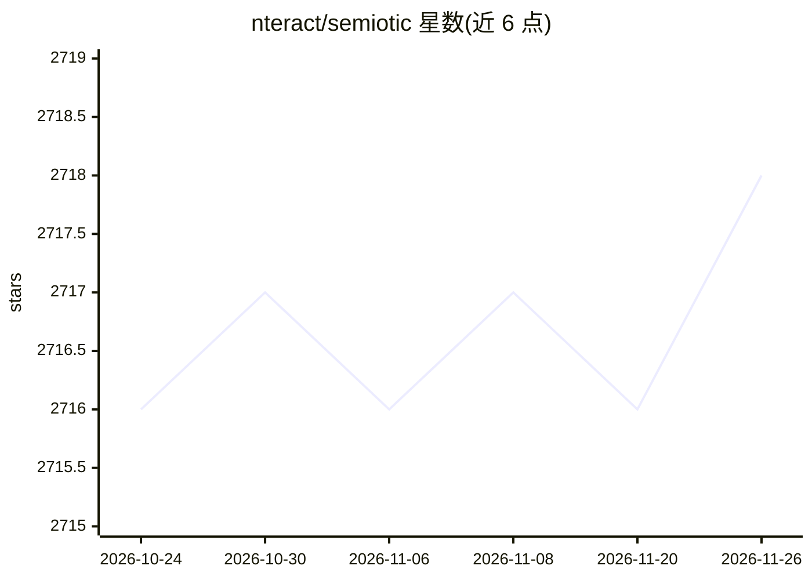

# nteract/semiotic

⭐ 2,718 · TypeScript · Apache-2.0 · 推送 2026-11-24 · [GitHub](https://github.com/nteract/semiotic) · [官网](https://semiotic.nteract.io) · 组织维护

**面向 AI 辅助开发的 React 数据可视化库**

Semiotic 是 React 数据可视化库，覆盖 XY/分类/网络/地理/实时/物理等图表族，以 accessor 驱动的统一 prop API 提供组件；实时图表基于 canvas 以 ref 推送渲染。针对 AI 辅助开发提供 schema 驱动的组件目录（semiotic/ai）、MCP 服务器、CLI 校验工具、anti-pattern 检测与数据预检，并包含 AGENTS.md/llms.txt 供编码代理读取。依赖 React 18.1+ 或 19，地理图表需可选 world-atlas peer dependency。

## 筛选速览

| 维度 | 判定 | 备注 |
|---|---|---|
| AI 角色 | `ai-enhanced` | 去掉 AI 部分产品仍成立 |
| 许可风险 | `permissive` | Apache-2.0 |
| 部署形态 | `library` | 以包/库形式分发 |
| 模型依赖 | — | README 未给出锁定关系 |
| 硬件要求 | — | 无带数字的原话,不猜 |
| 安装摩擦 | `low` | 无编译、无系统依赖或容器化 |
| 成熟度 | — | 结构信号不足 |

## 能力要点

- 多图表族统一 API：XY、分类、网络、地理、实时、物理、自定义布局
- 面向 AI 辅助开发：schema.json、MCP 服务器、semiotic-ai --doctor 校验
- Vega-Lite spec 翻译与 toConfig/fromConfig JSON 往返序列化
- 内置错误边界、可访问性（aria-label、键盘图例）与 LinkedCharts 协同视图

## 适用场景

- 在 React 应用中渲染流式实时监控图表
- 构建联动筛选的数据仪表盘
- 让编码代理生成并校验图表配置
- 将 Vega-Lite spec 转换为 Semiotic 组件

## 场景标签

 · 领域:前端/数据可视化

## 证据(README 行号)

> L12: A React data visualization library designed for AI-assisted development and streaming data.
> L190: Semiotic is a data visualization library for React that combines broad chart
> L203: - **`semiotic/ai`** — a single import with the schema-backed chart capability catalog (XY, ordinal, network, realt

## 星数曲线

2026-10-24 2,716 → 2026-11-26 2,718（+2）

---
*卡片 v1 · prompt 1.4 · 生成 2026-11-24 · 置信度 high · 依据 README sha `a41a562e7220` · [字段定义](../../DATASET.md)*
