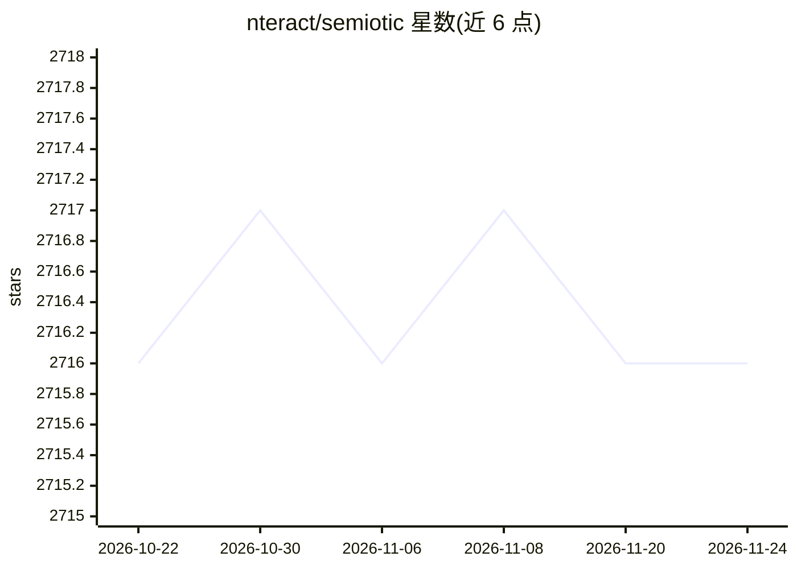

# nteract/semiotic

⭐ 2,716 · TypeScript · Apache-2.0 · 推送 2026-11-22 · [GitHub](https://github.com/nteract/semiotic) · [官网](https://semiotic.nteract.io) · 组织维护

**面向 AI 辅助开发的 React 数据可视化组件库**

提供 XY、分类、网络、地理、实时流、物理模拟等家族的 React 图表组件，共用 accessor 驱动的 prop API；实时图表基于 canvas 渲染并通过 ref 推送数据，支持 LinkedCharts 联动视图与 Vega-Lite spec 翻译。针对 AI 辅助开发场景，附带 schema 驱动的组件目录、MCP 服务器、CLI 校验工具、反模式诊断与数据预检，以及 AGENTS.md/llms.txt 等机器可读文档；每个图表内置错误边界、开发态校验警告与键盘/无障碍支持。需 React 18.1+ 或 19，经 npm 安装。

## 筛选速览

| 维度 | 判定 | 备注 |
|---|---|---|
| AI 角色 | `ai-enhanced` | 去掉 AI 部分产品仍成立 |
| 许可风险 | `permissive` | Apache-2.0 |
| 部署形态 | `library` | 以包/库形式分发 |
| 模型依赖 | — | README 未给出锁定关系 |
| 硬件要求 | — | 无带数字的原话,不猜 |
| 安装摩擦 | `low` | 无编译、无系统依赖或容器化 |
| 成熟度 | — | 结构信号不足 |

## 能力要点

- 覆盖 XY/分类/网络/地理/实时/物理等家族的 React 图表组件
- 提供 semiotic-mcp MCP 服务器与 CLI doctor 校验工具
- schema 驱动的组件目录与 diagnoseConfig 反模式检测
- LinkedCharts 跨图表联动与 Vega-Lite 双向翻译

## 适用场景

- 为 React 应用添加流式监控大盘与实时图表
- 构建网络关系图、桑基图与地理可视化
- 让编码助手基于 schema 生成并校验图表配置

## 场景标签

 · 领域:开发者工具/数据可视化

## 证据(README 行号)

> L12: A React data visualization library designed for AI-assisted development and streaming data.
> L199: Semiotic provides a workflow for generating, checking and repairing chart
> L203: - **`semiotic/ai`** — a single import with the schema-backed chart capability catalog (XY, ordinal, network, realt

## 星数曲线

2026-10-22 2,716 → 2026-11-24 2,716（+0）

---
*卡片 v1 · prompt 1.4 · 生成 2026-11-23 · 置信度 high · 依据 README sha `1492991e38a2` · [字段定义](../../DATASET.md)*
